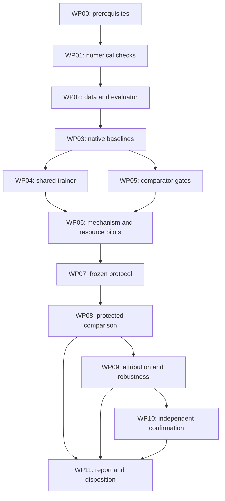

# Quantization disturbance training: research assessment and executable local proof-of-concept plan

**Research date:** 28 October 2026.  
**Target:** one MacBook Pro with an M3 Max; actual memory, GPU configuration, macOS and storage must be discovered.  
**Status:** researched experimental plan, not a demonstrated improvement. No pretrained-model training, M3 benchmark or packed-model accuracy experiment has been executed for this report. Small mathematical checks were executed on Linux/x86-64 and are identified separately.  
**Deliverable:** a standalone handoff to a coding agent. All commands beginning `python -m qprobe` and all `qprobe` interfaces below are **proposed project code to implement**, not existing package commands. References use ordinary Markdown links and are collected in Section 12.

## 1. Executive assessment and selected direction

### 1.1 Verdict

The original idea identifies a useful objective: improve the behavior of a quantized model by spending more computation before deployment, while keeping its deployed representation and operations unchanged. **That objective and most of the proposed ingredients already exist.** In particular, QDrop mixes quantized and floating-point block inputs; AE-Qdrop continuously interpolates between them and subsequently uses global distillation. Noise-based quantization robustness, quantization-aware distillation, and preservation of consequential input changes also have substantial prior art. Measuring an error and interpolating along it is therefore not, by itself, a defensible novelty claim. [R04] [R05] [R06] [R10] [R11] [R15]

The recommended research direction is a **controlled test of coherent, context-specific quantization-disturbance probes centered on the deployed hidden trajectory**, with a refinement that separates quantization error from adaptation drift. The potential contribution is initially an empirical finding and a deployment-faithful implementation. Methodological novelty remains unestablished.

Use the following primary configuration:

- **Model:** the original `Qwen/Qwen3-0.6B-Base`, with its exact revision, tokenizer and license recorded. This is a base model; use continuation prompts, not an assumed chat template. Its small size makes full decoder adaptation a credible local experiment. [R30]
- **Deployment contract:** native MLX affine four-bit weights, group size 64, BF16 group scales and additive offsets, BF16 activations, unquantized BF16 normalization parameters and KV cache. Include the tied embedding/output matrix in four-bit storage. Freeze that matrix and normalization parameters in the initial mechanism experiment; train the decoder linear matrices. Measure the actual complete artifact size. This format costs approximately **4.5 bits per quantized weight**, including both group metadata values. [R25] [R26]
- **Teacher:** the fixed original BF16 model, used for output-distribution targets.
- **Shadow:** the student's current latent weights evaluated with quantization disabled. It shares the current latent arrays; it is not a separately optimized model.
- **Disturbance:** the quantized prefix minus the same-current-weight shadow prefix on exactly the same tokens.
- **Intervention:** small coherent positive and negative multiples of that detached disturbance, added to the current differentiable quantized hidden state at one residual-block boundary.
- **Learning objective:** final-output distillation plus identically shared supervised semantic pairs. No requirement that every hidden state resemble the teacher or contract every disturbance.
- **Decisive comparisons:** tuned ordinary distillation with the same pairs, matched generic and shuffled-error noise, an AE-Qdrop-style interpolation control, and the strongest eligible local format-compatible quantizers/adaptation methods.
- **Final evidence:** quality and performance measured after exporting and reloading an ordinary packed model in the unmodified inference path.

The all-model 0.6B packed payload is calculated at about **0.312 GiB**; its decoder Adam training state is about **6.563 GiB** before teacher weights, activations and other memory. These are arithmetic estimates, not M3 measurements. The proposed path is plausible on a 36 GB configuration, subject to the explicit implementation and memory gates below. [R30] [R31]

### 1.2 What would constitute a worthwhile result?

There are three separate claims; do not collapse them:

1. **Mechanism:** context-matched quantization directions improve held-out output fidelity beyond ordinary distillation, generic noise, and existing interpolation mechanisms under controlled data and computation.
2. **Practical usefulness:** the actual exported model improves the quality/cost frontier over the strongest runnable local alternatives, without a material regression in meaningful distinctions, natural-text likelihood or generation behavior.
3. **Deployment structure:** the improvement uses the same tensor inventory, format, metadata dtypes and inference graph. This is checkable exactly. Equal measured latency requires separate evidence.

A win on the first does not automatically establish the second. A smaller teacher KL is not automatically better task accuracy. A structurally identical graph is not proof that two timings are equivalent. A successful 0.6B experiment is not evidence of a breakthrough across model families or scales.

If ordinary distillation, AutoRound, DWQ or an interpolation control matches the proposal once fairly tuned, report that the proposed special mechanism has not earned its cost. That is a useful outcome, not a reason to weaken the controls.

### 1.3 Changes from the original idea

These changes preserve the same-runtime intent and are deliberate:

| Original element | Adopted interpretation or correction | Why it matters |
|---|---|---|
| `h_Q(current) - h_T(original)` called quantization error | Use `h_Q(current) - h_R(current)` as the primary disturbance; retain the original residual as an ablation | The original residual includes adaptation drift after weights change |
| A probe written `h_T + alpha * stop_gradient(e)` | Use differentiable `h_Q + eta * stop_gradient(e)` | Preserves the prefix gradient; a zero probe then reproduces ordinary distillation, including its gradient |
| An unspecified neighborhood | Symmetric coherent probes `eta = ±r`, with a predefined radius search | Cancels the first-order displacement in the paired auxiliary loss and distinguishes near-deployment training from interpolation toward a floating state |
| Perhaps a 1–3B model | 0.6B default; 1.7B only after a measured capacity and information-gain gate | A meaningful complete local experiment is preferable to an unverified memory assumption |
| “Four-bit” as a storage shorthand | Exact byte inventory, including scales, offsets, norms and tied tensors | Metadata and exemptions can erase nominal comparisons |
| Possible novelty of the combination | No novelty assertion; test a narrow, potentially differentiated empirical hypothesis | QDrop, AE-Qdrop and counterfactual-preserving quantization materially overlap |

## 2. Problem, scope, assumptions and hypotheses

### 2.1 Beneficiary and bottleneck

The intended beneficiary is a developer distributing a pretrained language model for local inference who can afford a one-time adaptation job but wants to retain an existing low-bit serving path. The task is to preserve useful model behavior after weight-only quantization. The proposed project does not train a foundation model, invent a number format, require NVIDIA-specific arithmetic, or add an inference correction branch.

The deployment workload is not specified. The initial experimental population is therefore **English continuation on a registered-site-balanced sample of public web text**, with separate encyclopedia and controlled semantic-shift checks. This is an explicit research scope, not a claim to represent all users, languages or applications. Long-form mathematical reasoning, code generation, multilingual quality and safety-critical use remain outside the primary claim.

The presumed bottleneck is a measurable quality gap between a strong four-bit model and its original teacher. That gap must be measured on development data before implementing expensive robustness training. If the best inexpensive baseline already closes the gap to the evaluation's sensitivity, the local opportunity is small; do not manufacture headroom with a deliberately weak quantizer.

### 2.2 Quantities and notation

Let `x` be an input token sequence, `theta_0` the original model parameters, and `theta` the current latent student parameters. Let `Q(theta)` denote the exact deployment quantization transformation, including metadata dtype and the frozen quantized embedding. Define:

\[
T(x)=f_{\theta_0}(x),\qquad
R_\theta(x)=f_\theta(x),\qquad
S_\theta(x)=f_{Q(\theta)}(x).
\]

`T` is fixed; `R` is a no-gradient view of the current student with the quantizer disabled; `S` is the quantized forward. At residual-block boundary `l`, with identical masks and positions:

\[
e_l^Q(x;\theta)=h_l^{S_\theta}(x)-h_l^{R_\theta}(x),\quad
e_l^{\mathrm{drift}}=h_l^{R_\theta}(x)-h_l^T(x).
\]

Then the original teacher–student discrepancy decomposes exactly:

\[
h_l^{S_\theta}-h_l^T=e_l^Q+e_l^{\mathrm{drift}}.
\]

For the initial decoder-only parameterization, `R` uses the current decoder latent matrices and the original dense frozen embedding/norms; `S` uses quantized current decoder matrices and the frozen quantized original embedding. Thus `e_Q` includes the quantization of the fixed embedding as well as the decoder. It does not include the difference between original and adapted decoder weights. The output-head quantization does not enter a pre-head hidden discrepancy but does enter the final-output loss.

“Full precision” in this report normally means the original **BF16** inference model, not exact real arithmetic or an FP32 foundation model. For `R`, use the same BF16 cast of the current FP32 latent weights that is fed to the quantizer. This excludes FP32-to-BF16 casting from the intended low-bit disturbance definition. Native packed versus dense arithmetic can still contribute numerical differences; Section 4.6 measures that component.

### 2.3 Established facts, assumptions and speculation

**Established mathematical facts.** For a linear layer with error matrix `E`, expected squared output error is `tr(E C E^T)`, where `C=E[xx^T]`; this is a second moment, not necessarily a centered covariance. Weight-wise distance need not track output error. Orthogonal coordinate changes preserve an isolated linear function if compensated correctly. Network nonlinearities and residual paths constrain where such transforms can be absorbed. Distillation, adaptive rounding and activation-aware quantization are established techniques. [R01] [R02] [R03]

**Required assumptions.** The selected model has recoverable low-bit degradation; calibration covers relevant behavior; a modest neighborhood of the natural quantized state contains useful training information; coherent actual-error directions contain information beyond their magnitude/covariance; the regularizer does not suppress necessary distinctions or disrupt useful residual cancellation; and the target machine can execute the precise training and export path.

**Not assumed.** Quantization errors are independent, zero mean, harmless because there are many weights, or orthogonal to semantic information. The teacher need not be correct on every example. A lower local reconstruction loss need not improve the final distribution. Recent work explicitly reports such mismatches. [R14] [R17]

**Speculative extensions.** Better behavior at 1.7B or another architecture, lower bit widths, on-policy rollouts, learned layer/radius selection, low-rank training parameterizations, and semantic-subspace-aware probes are follow-up hypotheses. None is required to rescue a negative primary experiment.

### 2.4 Falsifiable hypotheses

| ID | Hypothesis and predicted observation | Strong alternative explanation | Observation that weakens it |
|---|---|---|---|
| H0: headroom | Strong local W4 baselines show a reproducible held-out quality/fidelity gap | The apparent gap is a tokenizer, export or harness defect | Gap disappears after correct baseline tuning or numerical repair |
| H1: directional information | Actual context-matched directions improve natural packed fidelity more than energy-matched generic or shuffled directions | Extra passes, generic smoothing, favorable calibration examples or token-wise energy allocation | Generic/shuffled noise or compute-matched KD matches the gain |
| H2: neighborhood contribution | Nonzero symmetric radius beats its exactly equivalent zero-radius control and old interpolation controls | Repeated KD or attraction toward a floating prefix explains improvement | `r=0`, elementwise/scalar interpolation, or extra ordinary KD catches up |
| H3: residual definition | Quantizer-only, energy-matched total and drift-only directions have distinguishable effects | Different magnitude, token allocation or adaptation-induced geometry explains the difference | Definitions perform alike after matching, or drift-only reproduces the gain |
| H4: useful discrimination | Pair both-correct accuracy and natural-text NLL are preserved or improve on fresh scenarios/domains | Insensitivity, copying teacher mistakes, template memorization | Answer-switching rises while correctness falls; new templates lose quality |
| H5: serving benefit | Packed export preserves the improvement under an identical deployment contract | Fakequant/packed arithmetic mismatch, extra precision, retained adapters | Gain disappears after reload, or payload/graph differs |
| H6: reproducibility | Effects repeat across independently trained runs and a separately frozen follow-up | One seed, one favorable domain, repeated inspection | Signs vary materially, uncertainty includes meaningful harm, or fresh confirmation fails |

Novelty is a literature and mechanism question, not an additional metric that becomes true when H1 succeeds.

### 2.5 Best case, strongest objection and theoretical limit

The best case is that real quantization produces structured, context-dependent disturbances whose downstream sensitivity is inadequately constrained by single-trajectory distillation. Small coherent probes teach tolerance in those directions while labels on semantic pairs discourage indiscriminate flattening. All added computation disappears at export.

The strongest objection is that this is expensive regularization of artificial states. The proposed directions may be no more useful than generic noise; ordinary distillation may absorb the same error with more updates; or the neighborhood objective may oppose the natural corrective behavior of later blocks. The null result is particularly plausible at four bits, where a well-tuned baseline may leave little headroom.

There is an information limit: if a numerical disturbance and a meaningful input change produce the **same complete downstream-relevant state**, a deterministic suffix cannot both ignore one and preserve the other. For a Transformer, that state includes the whole visible boundary tensor or its corresponding cache, not only the last token's hidden vector. Cosine similarity between two selected vectors is only a diagnostic and does not prove separability.

Residual error can partly cancel through depth. Therefore the plan optimizes final distributions and actual correctness, and logs hidden norms/cross terms only as diagnostics. It never assumes that reducing every local error improves the complete model. [R17]

## 3. Research landscape, prior art and novelty assessment

### 3.1 Closest alternatives

The table separates inspected source claims from the proposed experimental interpretation. Reported results are not controlled comparisons with this project's model or hardware.

| Prior art / capability | Mechanism and assumptions | Evidence setting / computational burden | Overlap and reuse | Consequence for this project |
|---|---|---|---|---|
| AdaRound; GPTQ [R01] [R02] | Task/layer-sensitive rounding; GPTQ uses input second moments to compensate sequential errors | PTQ; calibration and matrix statistics rather than full retraining | Function-sensitive code selection is established; native MLX GPTQ is reusable | RTN alone is an inadequate competitive baseline |
| AWQ [R03] | Activation-aware scaling/clipping, with compensating transformations | Weight-only LLM PTQ; calibration and search | Reuse native supported Qwen implementation and folded transformations | Verify exact final format and include tuned AWQ |
| QDrop [R04] | Randomly substitutes floating and quantized block inputs/activations during reconstruction | Vision and BERT experiments, low W/A bits; local reconstruction | Already uses context-dependent real discrepancies, including upstream block-input errors | A “measured hidden error” claim alone is not new |
| AE-Qdrop [R05] | Elementwise uniform interpolation `t*q_y+(1-t)*y`; block reconstruction followed by global feature/logit matching | Inspected preprint: CNN ImageNet classification; its full two-stage method differs from W4A16 LLM adaptation | Continuous actual-error interpolation and downstream matching are prior art | Include interpolation-law controls; label the LLM transfer as an adaptation, not a paper-exact reproduction |
| LLM-QAT; BitDistiller [R06] [R07] | Teacher-guided quantized adaptation; BitDistiller also uses asymmetric quantization and a confidence-dependent divergence | LLMs, including sub-four-bit settings; original GPU-oriented code and formats | Strong existing QAD family; loss and initialization can explain gains | Use strong tuned KL/CE variants; preserve differences when porting a loss |
| LR-QAT; EfficientQAT [R08] [R09] | Low-rank parameterization inside the quantizer, or blockwise QAT followed by end-to-end scale learning | Larger LLMs; lower training memory than naive full adaptation | Established paths to unchanged deployment and memory reduction | Conditional resource fallback or stronger frontier comparison, with exact export verification |
| FPQ [R10] | Stochastic feature noise with standardized feature distillation | CIFAR QAT; no demonstrated M3/LLM result inspected | Generic feature perturbation plus distillation is established | Generic-noise and reconstruction controls are necessary |
| NPFT; gradient regularization [R11] [R12] | Perturb sensitive weights during PEFT, or penalize sensitivity to bounded numerical errors | LLM/vision settings respectively; gradient methods may require extra derivatives | Numerical tolerance learned offline is established | Proposed value must be directional/contextual, not merely “robustness training” |
| Jacobian-guided noise [R13] | Attention-logit Gaussian noise scaled by a softmax sensitivity statistic | 2026 LLM/SigLIP paper; multiple bit settings and some regressions | Contemporary sensitivity-conditioned noise comparison | Reproduce only if attention-path equivalence is established; do not import its theoretical guarantees |
| YAQA [R16] | Full-output-KL-aware curvature approximation for rounding | LLM quantization; implementation based on QTIP and format-specific machinery | Output-aware offline optimization is established | Strong reference; direct comparison requires a compatible format or separate Pareto accounting |
| DRQ [R14] | Integer-code refinement on a fixed grid using a worst-case reconstruction objective | October 2026 preprint; W2–W4/A16, group 128; original experiments on large NVIDIA GPUs | Same runtime and robust calibration are close competitors | Attempt a faithful local arithmetic port if the source/algorithm gate passes; no exclusion merely because published runs used a GPU |
| CFQ; QuanDCL [R15] [R18] | Preserve counterfactual decision changes or contrastive feature structure during quantization | Tabular recourse or vision, respectively | Preserving consequential distinctions alongside quantization is also established | Minimal pairs are a task-specific control/design choice, not an independent novelty claim |
| On-policy low-bit distillation [R19] | Train on quantized student rollouts with teacher feedback, optionally task-verifier rewards | Recent small-to-medium reasoning LLMs at sub-three effective bits | Addresses autoregressive distribution shift beyond teacher forcing | Required context and an evidence-triggered pivot if free generation remains the failure mode |
| Native MLX DWQ; AutoRound [R23] [R24] [R29] | Tune existing quantization parameters or blockwise rounding; native packed export | Local MLX methods; AutoRound documents CPU quantization and experimental MLX export | Reusable strong practical alternatives with no extra serving branch | Both deserve feasibility checks and fair tuning; do not classify AutoRound as CUDA-only |
| NVIDIA QAD; QATFactory [R20] [R21] | Teacher distillation and deployment-aligned fakequant/export | Different hardware/formats and larger training setups | Same-runtime recovery and numerical alignment are already practiced | Reference evidence, not interchangeable benchmark numbers |

Broader checks also found concentration/alignment analysis, image-robustness work, a prior quantization-noise patent publication, diffusion-model training with plain low-bit operators, and deployed same-format QAD releases. These reinforce the limited novelty assessment but do not supply comparable M3/Qwen results. [R39] [R40] [R41] [R42] [R44]

The Jacobian-noise paper's inspected table includes worsening perplexity in some settings. Its trace argument also needs a lower curvature bound on the relevant subspace; a smallest positive eigenvalue of a semidefinite matrix is insufficient when the Jacobian has components in the nullspace. The present plan relies on its empirical mechanism as a comparator, not on a universal guarantee. FPQ's claim that injected zero-mean disturbances necessarily produce bias also has linear counterexamples. These observations motivate tests, rather than discarding the methods. [R10] [R13]

### 3.2 Six explicit prior-art answers

**What already exists?** Every broad ingredient: quantized distillation, actual-error mixing, continuous interpolation, noise regularization, sensitivity-aware optimization, preserving useful input changes, and unchanged-runtime export.

**What can be reused?** MLX/MLX-LM model execution, packed formats and native quantizers; the original Qwen weights/tokenizer; official AutoRound export where verified; dataset readers; ordinary Adam/checkpointing; and published interpolation laws. Build only the intervention executor, exact shared objectives, controlled experiments and reporting that are absent.

**What might differ substantively?** A carefully isolated treatment using a current-weight shadow, coherent symmetric probes near the deployed trajectory, final-output supervision, and explicit semantic checks under one deployment contract. No inspected source establishes that this entire controlled question has already been answered. That is weaker than claiming a new algorithm.

**Why might it produce value?** Context-aligned directions could contain task-relevant information lost by marginal-noise models, and near-deployment probes could regularize a more relevant neighborhood than interpolation toward floating states. Both are hypotheses.

**What experiment isolates it?** The shared-trainer comparison in Section 5: same latent initialization, trainable mask, data, targets, boundary schedule and export; actual versus shuffled/matched-noise directions; centered versus interpolation probes; and more ordinary KD within the same elapsed adaptation budget.

**What would invalidate a novelty claim?** A prior implementation of the same intervention/objective with equivalent controls; an algebraic equivalence to an existing method under the chosen parameterization; or a finding that the benefit comes entirely from established interpolation, extra optimization or better examples. Positive quality alone never establishes novelty.

### 3.3 Selection among credible directions

| Direction | Value and distinctiveness | Local feasibility / falsifiability | Decision |
|---|---|---|---|
| Better fixed-grid rounding or DWQ | Strong practical value; extensively established | Native baselines are accessible; clean byte-level comparison | Establish first; stop there if sufficient |
| Original teacher-discrepancy probes | Plausible but confounded after adaptation and close to prior interpolation | Easy once split execution works | Retain as an attribution arm |
| Current-weight, centered coherent probes | Narrow empirical differentiation; uncertain benefit | Fits a complete 0.6B causal experiment; zero-radius and shuffled controls are decisive | **Primary research treatment** |
| Low-rank high-precision correction at inference | Could recover concentrated error; known family | Extra storage/kernels violate the primary unchanged-graph question | Optional Pareto reference only |
| Learned rotations or new codebooks | Strong prior results; more runtime/format complexity | Changes the deployment contract unless fully absorbed and verified | Broader reference, not a substitute mechanism |
| On-policy adaptation | Directly addresses rollout failure; already established | Additional generation/teacher cost; meaningful only if the model can perform the task | Pivot when teacher-forced recovery fails to transfer |
| Speculative decoding | Can preserve a target distribution under its algorithmic assumptions | Requires the full target and a different memory/latency tradeoff | Outside the stated replacement-model objective |

The primary experiment is worthwhile even if its final contribution is a negative result that bounds the value of contextual perturbations after strong QAD. Do not rename existing interpolation as an invention.

## 4. Mechanism and implementation specification

### 4.1 Deployment contract and authoritative quantizer

Represent each eligible logical weight matrix `W[out,in]` using a packed unsigned code array, BF16 scales and BF16 **additive offsets**. For each contiguous last-axis group of 64:

\[
\widehat W_i=s_g q_i+b_g,\qquad q_i\in\{0,\ldots,15\}.
\]

Use the pinned native `mlx.core.quantize` and `dequantize` implementations as the authority for rounding, range selection, constant groups, metadata rounding and bit packing. Do not replace them with a generic min/max formula and assume parity. Native packing uses uint32 words; the metadata and group layout are part of the scientific condition. Reject NaN/Inf input weights rather than silently clipping them away. [R25]

Export all supported decoder matrices and the tied embedding matrix in this format. Store the tied matrix once and use its quantized lookup and linear-head operations. Preserve biases and normalization parameters according to the original architecture; do not invent missing biases. The initial Qwen configuration has seven decoder linear matrices per block, 28 blocks, width 1024, FFN width 3072, 16 query heads, 8 KV heads and head dimension **128**. Thus the query projection is width 2048; `hidden_size / num_heads` would be incorrect. Read these from the actual pinned configuration, never hard-code a generic Transformer assumption. [R26] [R30]

`format_manifest.json` must enumerate every tensor's logical/stored shape, dtype, bit width, group axis/size, code/scale/offset names, shared-storage identity, trainability and exemption reason. Include tokenizer and architecture hashes, inference entry point and quantizer implementation SHA. Compare manifests programmatically across methods. Values may differ; format, aliasing and graph must not.

### 4.2 Exact loss and probe semantics

Let `G_theta,l` be the quantized suffix after boundary `l`, including final norm and output head. On a training sequence, compute without gradients:

\[
d_l=\operatorname{stopgrad}(h_l^{S_\theta}-h_l^{R_\theta}).
\]

During a differentiable quantized forward, construct:

\[
h_l^+=h_l^{S_\theta}+r d_l,\qquad
h_l^-=h_l^{S_\theta}-r d_l.
\]

The scalar `r` is shared across all valid tokens and channels of one sequence; this preserves the measured direction's temporal/channel structure. Padding entries have zero perturbation. Sample one boundary per microbatch uniformly from after blocks 7, 14 and 21 for the 28-block default. Express these boundaries as fractions in config for other models. This schedule is fixed and shared across the causal controls; do not select a convenient layer after seeing test results.

**Probe numerical convention:** compute `d = float32(h_S) - float32(h_R)` and all direction norms/statistics in FP32. Inject as `(float32(h_S) ± r*d).astype(BF16)` before the suffix. The intended perturbations are symmetric; the **realized BF16 displacements need not be**. Log realized energy, the fraction rounded to zero, and `||(delta_plus+delta_minus)/2||`. Small probes that vanish after casting cannot test the proposed neighborhood. Do not silently switch suffix activations to FP32 to rescue them.

For temperature `tau`, define the token-averaged forward distillation loss:

\[
K_\tau(z_T,z_S)=\tau^2\frac{1}{|M|}\sum_{t\in M}
\mathrm{KL}\!\left(\operatorname{softmax}(z_{T,t}/\tau)\,\Vert\,
\operatorname{softmax}(z_{S,t}/\tau)\right).
\]

`M` contains only valid next-token targets. Compute log-softmax and KL reductions in FP32; retain full vocabulary support. Teacher probabilities and disturbances are detached. The primary evaluation always uses `tau=1`, regardless of training temperature.

The natural-text objective is a normalized mixture:

\[
L_{\mathrm{text}}=(1-\lambda)K_\tau(T,S)
+\frac{\lambda}{2}\{K_\tau(T,G(h_l^+))+K_\tau(T,G(h_l^-))\},
\quad 0\leq\lambda\leq1.
\]

Consequently `r=0` gives **exactly ordinary KD**, not `(1+lambda)` times KD. This matters when another loss or gradient clipping is present. Test value and gradient equality, not only forward state equality.

Every pair-enabled arm also receives:

\[
L_{\mathrm{pair}}=\tfrac12[-\log p_S(y_a\mid x_a)-\log p_S(y_b\mid x_b)].
\]

For a multi-token answer, each negative log-probability above is the **sum over all answer tokens**. Average the two members, then average over scenarios; do not divide by answer length. Use the **natural unperturbed** student for pair CE in the core experiment; apply the same pair data, weight and scheduling to all pair-enabled arms. Both sides have independently computed correct labels. Do not enforce identical outputs for the two different semantic inputs. Combine losses as `(1-beta)*L_text + beta*L_pair` after separately normalizing each; `beta=0` is the no-pair control. Optional natural-token CE is a shared tuned baseline variant, not a private enhancement of the proposal.

Initial exploratory settings are `tau=1`, `lambda=0.5`, `r=0.25`, `beta=0.1`. These are starting points, not validated constants. Search neighborhoods and allocation rules are in Section 5. No additional hidden-state MSE is present in the primary treatment.

### 4.3 What the symmetric objective does—and does not imply

For a smooth fixed suffix and fixed detached direction, Taylor expansion gives:

\[
\tfrac12\{\ell(h+r d)+\ell(h-r d)\}
=\ell(h)+\tfrac{r^2}{2}d^\top\nabla_h^2\ell(h)d+O(r^4).
\]

It removes the first-order displacement term. It does **not** guarantee a positive curvature penalty throughout training. For the **temperature-one** teacher KL through nonlinear logits:

\[
\nabla_h^2\ell
=J_z^\top(\operatorname{diag}(p_S)-p_Sp_S^\top)J_z
+\sum_k(p_{S,k}-p_{T,k})\nabla_h^2 z_k.
\]

The second term vanishes at exact distribution matching, but can otherwise matter. The Fisher-like interpretation is local and conditional, not a theorem that the proposed training will improve a finite-precision network. BF16 arithmetic and code transitions further limit a continuous approximation.

At general temperature with the `tau^2` loss multiplier, replace probabilities by their temperature-scaled versions and multiply the second, residual term by `tau`. The expansion holds with a fixed direction. The implemented update refreshes `d(theta)` but omits its derivative; it is a **semi-gradient update**, not proof of gradient descent on the fully parameter-dependent robustness functional. The quantizer intervention is isolated conditional on current `theta`; adaptation still changes its geometry over time.

The intervention also differs from the original fixed-teacher interpolation once adaptation occurs. With the current-weight shadow, `h_R + (1±r)(h_S-h_R)` equals the two probe values, but the implementation uses `h_S±r*stopgrad(e)` to preserve prefix gradients.

### 4.4 Prefix/suffix execution invariants

Implement a project-owned adapter around the inspected MLX-LM Qwen3 modules; avoid undocumented global hooks. [R27]

```python
# Proposed project interfaces; implement and test against the pinned model.
class ModelAdapter:
    def prefix(self, tokens, boundary, mode, *, mask, positions): ...
    def suffix(self, hidden, boundary, mode, *, mask, positions): ...
    def logits(self, tokens, mode, *, intervention=None): ...
    def parameter_manifest(self): ...
    def export_packed(self, destination, format_manifest): ...

# mode is teacher, shadow, or student. There are no mutable training KV caches.
# boundary=k means after exactly k residual blocks, before block k+1 normalization.
```

At training time, pass the full sequence tensor through the suffix with the same causal mask and position indices. Recompute suffix attention for every intervention. Never reuse natural-forward K/V tensors in a perturbed suffix: they encode a different trajectory. `suffix(prefix(tokens))` must match the original model with no intervention, including tied head, RoPE, q/k normalization and padding behavior. No dropout, randomized attention approximation or generation sampling is allowed in this identity test.

The inspected native Qwen model call creates its own mask and is not a generic `attention_mask`/`positions` API. The proposed adapter must explicitly call the existing blocks with the appropriate mask, rather than pass invented keyword arguments to the model. Reuse the pinned native create_attention_mask helper and its causal-mask dispatch so split execution retains the original optimized attention path. Use unpadded batch-one inputs by default and reset positions through the native no-cache RoPE path. If later batching, use a validated right-padding mask that prevents padded keys and future positions from influencing valid outputs.

Disturbances are refreshed **before every optimizer update** from the unchanged current parameters. All natural, plus, minus and pair branches within an update use those same parameters. Never step between branches. A delayed-refresh experiment is a separately named ablation. Do not accumulate a queue of directions from protected evaluation inputs.

### 4.5 Native packed forward with an explicit STE

The preferred training forward calls the same native packed matmul used by exported inference. A custom VJP supplies a stated straight-through estimator (STE) for latent weights. This is proposed project code using documented MLX extension points, **not a claim that an off-the-shelf complete QAT trainer has been tested on M3**. [R25] [R28]

```python
# Reference implementation sketch. Validate the selected MLX signature locally.
import mlx.core as mx

@mx.custom_function
def qat_linear(x, w32):
    q, s, b = mx.quantize(w32.astype(mx.bfloat16),
                         group_size=64, bits=4, mode="affine")
    return mx.quantized_matmul(x, q, s, b, transpose=True,
                              group_size=64, bits=4, mode="affine")

@qat_linear.vjp
def qat_linear_vjp(primals, cotangent, output):
    x, w32 = primals
    q, s, b = mx.quantize(w32.astype(mx.bfloat16),
                         group_size=64, bits=4, mode="affine")
    wq = mx.dequantize(q, s, b, group_size=64, bits=4, mode="affine")
    dx = (cotangent @ wq).astype(x.dtype)
    xf = x.reshape(-1, x.shape[-1]).astype(mx.float32)
    gf = cotangent.reshape(-1, cotangent.shape[-1]).astype(mx.float32)
    dw = gf.T @ xf
    return dx, dw.astype(w32.dtype)
```

This treats the reconstructed quantized matrix as the input derivative and the identity as the surrogate weight derivative. It is deliberately **not** the true derivative of a discontinuous quantizer. Finite-differencing the discrete forward with respect to weights would usually return zero between thresholds and is not a test of this STE. Test `dw` against the declared analytical surrogate. Test input/loss/intervention derivatives on a smooth dense FP64 reference using the exact reconstructed coefficients; separately test packed-output parity. Finite differences through BF16 casts can themselves vanish and are not a smooth oracle. Pass trainable arrays explicitly into custom functions—captured arrays are not automatically differentiable.

The frozen quantized embedding/head uses native quantized lookup and `as_linear`. Its output-head input gradient must match multiplication by the reconstructed matrix. If that native gradient fails, a custom input VJP can preserve the packed forward. Only if that also fails may a BF16 embedding/head exemption be considered; it changes the deployment contract and must apply to every comparator. It raises the default model's calculated overall rate to approximately 7.50 bits/weight, which must be disclosed.

Start every causal QAT arm from the same original latent `theta_0` and canonical native quantizer. A GPTQ/AWQ/DWQ artifact is a **separate strong comparator**. Do not dequantize it, recompute min/max grids, and silently call the result the same initializer: `Q(DQ(q,s,b))` need not preserve optimized codes or scales. A learned-grid warm start requires an explicit fixed-grid quantizer or an all-group identity proof, and a new registered experimental condition.

### 4.6 Numerical fidelity and error decomposition checks

The preferred packed path still has several distinct errors. On development inputs compare:

1. Original package BF16 teacher versus project teacher wrapper.
2. Native packed student versus a dense forward using the exact reconstructed quantized weights.
3. Dense reconstructed student versus the same-current-weight BF16 shadow.
4. Student immediately before export versus reloaded native packed export.

The second measures kernel arithmetic effects; the third isolates low-bit weight reconstruction under the dense path. Log their effect on hidden disturbances and output KL. If arithmetic mismatch is comparable to the claimed treatment effect, use common packed evaluation for all claims and state whether the treatment is responding to combined deployment numerics. If the causal interpretation still depends on separating them, add a dense-weight-only disturbance ablation before making that interpretation.

A dense fakequant training fallback may use the same exact quantize/dequantize transformation with an identity VJP. It preserves stored weights but can change arithmetic, memory and throughput. Label it as a different training path; require its packed-export discrepancy to be small relative to the effect under study and compare all causal arms through that same path. A fakequant-only gain is not a deployed result.

### 4.7 Memory-bounded update algorithm

```text
inputs: current latent theta; frozen teacher T; text batch; semantic pair batch
        chosen boundary l; radius r; lambda, beta, tau; explicit RNG states

1. Freeze the optimizer step index and sample IDs for this complete update.
2. Obtain teacher targets on text (online, or exact validated cached terminal states).
3. Without gradients, run current student prefix and current shadow prefix to l.
   Evaluate lazy results; d = stop_gradient(h_student - h_shadow); zero padded d.
4. Construct the selected control direction from d using training-only information.
5. Accumulate gradients in separate passes, without updating theta:
   a. natural student loss with coefficient (1-beta)*(1-lambda)
   b. plus-probe student loss with coefficient (1-beta)*lambda/2
   c. minus-probe student loss with coefficient (1-beta)*lambda/2
   Each pass recomputes a differentiable student prefix and adds a detached delta.
6. Accumulate natural semantic-pair CE gradients with coefficient beta.
7. Sum in FP32; apply one shared global-gradient clipping rule; take one Adam update.
8. Evaluate the optimizer state; log losses, valid counts, norms, time and memory.
9. At registered checkpoints, export and evaluate development data, then checkpoint.
```

Serial branches avoid retaining three suffix graphs. They cost extra complete forwards/backwards, and this cost must be charged. Because MLX is lazy, evaluate each accumulated gradient before releasing its branch graph/obsolete arrays; after Adam, evaluate both updated weights and optimizer state before the next step/checkpoint. A shared-prefix graph implementation is an optional optimization only after it matches the serial reference's loss and gradients. Exact teacher terminal-state caching can avoid repeated teacher-body computation: cache the actual post-final-norm BF16 states and reconstruct all-vocabulary logits with the unchanged teacher head. Validate cache parity, preserve all provenance and charge cache creation to offline cost. Never substitute top-k-renormalized teacher probabilities without labeling a changed objective.

Initial optimizer choices: Adam with FP32 masters/gradients/moments, zero weight decay for fidelity adaptation, global gradient norm clipping at 1.0, linear warm-up over 5% of the selected update budget then cosine decay. Begin learning-rate search at `1e-5`, `3e-5`, `1e-4`; include a neighboring decade only when a development curve or divergence diagnosis warrants it. These are proposed, shared starting settings; a documented baseline-specific better schedule is allowed. Record all discarded configurations.

### 4.8 Indispensable mechanism checks before training

Run these small checks before full model downloads or long jobs:

- A correlated-input two-weight example demonstrates that coordinated rounding can reduce output error despite larger weight error; a changed input correlation reverses the advantage. This validates the objective distinction, not model efficacy.
- `r=0` and `lambda=0` reproduce KD values **and gradients**, including pair loss weighting and clipping.
- A detached direction receives no gradient, while the student prefix still does; perturbing the teacher targets has no gradient effect on teacher parameters.
- Same-current-weight decomposition sums exactly within floating-point tolerance; at initialization, adaptation drift is zero.
- Positive and negative intended FP32 probes have equal norm/opposite sign at the same boundary. Their realized BF16 energies/asymmetries are measured, with identical masks and causal positions.
- A linear-logit softmax toy recovers the predicted second-order directional term as radius decreases; a semantic-state collision example demonstrates the limitation rather than being “fixed” by a regularizer.
- Synthetic evaluator controls detect an intentionally introduced output error and assign identical scores to identical artifacts. A null result caused by a broken evaluator must be impossible to mistake for evidence against the hypothesis.

## 5. Baselines, data and confirmatory evaluation

The evaluation contract in this section precedes architecture choices. Any implementation shortcut that changes its population, numerical condition, information access or comparator scope requires a methodological amendment.

### 5.1 Baseline inventory and labels

| ID | Implementation and role | Required configuration / reproduction check | Direct claim eligibility |
|---|---|---|---|
| `T` | Original BF16 teacher | Same model/tokenizer revision and evaluation wrapper; teacher-to-teacher KL null | Quality/fidelity anchor, not compressed competitor |
| `RTN` | Native MLX quantization | Four bits, group 64, BF16 scale+offset, prescribed tensor mask | Simple floor; never sole competitive baseline |
| `GPTQ` | Pinned native MLX-LM implementation | Explicit sample count, group 64 and **four-bit fallback**; tune damping/calibration; unpack and reload | Mandatory native local baseline |
| `AWQ` | Pinned native MLX-LM Qwen3 path | Same group/bit/dtype mask; tune scale/clip search; transformations folded and accounted for | Mandatory native local baseline |
| `DWQ` | Pinned native MLX-LM distillation | Give the development-best eligible target-format PTQ initializer, including AutoRound/DRQ, a refinement opportunity within the total budget | Mandatory practical adaptation baseline |
| `AR` | Official AutoRound CPU calibration and MLX export, in an isolated environment | Standard recipe before Light; exact code/metadata conversion gate; target-format embedding treatment | Mandatory eligibility test; run full baseline if faithful and projected resources fit |
| `DRQ` | Independent portable implementation of the published fixed-grid objective/search | Small-matrix oracle, one real block, fixed-grid/cap checks; pair each refinement path with its matching RTN/GPTQ base | Mandatory eligibility test; label independent implementation and protocol adaptations |
| `D` | Shared packed-forward QAT trainer, ordinary output KD | Same latent initialization/mask/optimizer; tune LR, temperature and budget | Mechanism anchor |
| `DP` | `D` with the exact semantic pair corpus and CE objective | Same pair exposure/weight as treatment | Required stronger-data control |
| `G` | `DP` plus isotropic or channel-scaled, norm-matched Gaussian noise | Same causal boundary/pass budget; measure intended and realized moments | Generic regularization control |
| `S` | `DP` plus donor-context measured directions | Training-only donors, different documents, matched layer/length/position; same norm | Context-pairing control |
| `I` | `DP` with coherent scalar interpolation toward the shadow | Two draws or antithetic uniform coefficients with same pass budget | Separates centered neighborhood from ordinary interpolation |
| `AE` | `DP` with elementwise uniform shadow/student interpolation | Same final-output objective and selected boundary | Closest interpolation-law transfer; **not** reproduction of the complete published CNN method |
| `M` | Selected current-weight, symmetric actual-direction treatment | Section 4 | Proposed treatment |
| `MT` | `M` using total teacher–student discrepancy instead | Compare raw and energy-matched forms; add a matched drift-only arm for causal attribution | Residual-definition diagnostic |

Native MLX-LM provides AWQ, GPTQ and DWQ; inspect the exact installed source and `--help`, because documentation and code defaults can differ. The inspected GPTQ implementation falls back to six-bit quantization for other modules unless explicitly configured. Its default unrestricted calibration count must also be overridden. The inspected DWQ cached-target path normalizes a top-1024 subset; use online full targets for the matched full-KL baseline, and optionally retain stock cached DWQ as a cheaper practical competitor with its objective disclosed. [R23] [R24]

**Broader trainable masks.** Decoder-only training is a resource/implementation choice, not a definition of the strongest QAT. If measured memory permits, implement a full-model KD comparator: one shared latent embedding/head matrix, quantized row lookup with a scatter-add STE, and the same latent matrix for the linear head. Test repeated token IDs, weight tying and summed input/head gradients. Give it the same measured offline budget. If this expands the best practical frontier, include it in `P*` below; optionally promote that mask to every causal arm before confirmation. Never change only `M`'s capacity. If the full-mask path is blocked, record the precise limitation and scope claims to the tested adaptation classes.

**AutoRound compatibility.** Official documentation advertises CPU optimization and experimental native MLX output, but excludes embedding quantization in the described export path. [R29] Retain its stock export on the byte/latency Pareto plot. For the target-format adaptation, make the student calibration forward use the prescribed frozen packed embedding where a validated adapter permits it. If only post-export embedding replacement is possible, label the calibration mismatch, tune the final artifact and give `AutoRound -> target-format conversion -> DWQ` a refinement opportunity within the budget. Do not treat post-export selection as repairing that mismatch. Decoder conversion must preserve learned codes, not requantize them. For affine zero-point storage, `s(q-z)=s*q+(-s*z)` algebraically; metadata casts can still change values. Native MLX export is preferred; a compatible AutoAWQ import must pass its own unpack/repack and `g_idx` restrictions. [R43]

**Nonlocal references.** YAQA's supplied repository depends on CUDA/Triton/QTIP components, while the underlying mathematics is portable. A faithful scalar-affine port would require additional Hessian/sketch and architecture work; do not call a different quantizer “YAQA” merely because it uses a similar loss. QATFactory, NVIDIA NVFP4 results, original large-scale LR-QAT/EfficientQAT, rotation/codebook systems and sub-three-bit on-policy results are reference context until their exact setting is reproduced. Their published scores are not head-to-head observations here. State “better than the tested local portfolio,” never “state of the art,” when a stronger reference remains unavailable. [R08] [R09] [R16] [R19] [R20] [R21]

### 5.2 Concrete matched perturbation controls

For a valid sequence-level disturbance `d`:

- **Isotropic:** draw IID standard normal entries `z`; set `d_G = ||d||_F z / max(||z||_F, eps)`, masking padding before normalization. Use the same symmetric `±r` and loss weights as `M`.
- **Channel-scaled, norm-matched:** estimate per-channel second moments of training disturbances at each boundary, draw `z_j ~ N(0,v_j)`, then normalize the whole sequence to `||d||_F`. Record whether moments are centered and measure the generated moments: this normalization generally changes even the diagonal covariance. Do not claim exact covariance matching.
- **Shuffled actual direction:** maintain a small training-only bank with sequence ID, boundary, valid length, relative-position bucket and current snapshot ID. Use a different document's direction, with an identical-length donor whenever possible, and sequence-norm-match it. Refresh donors under the same current parameters for the core control; a stale bank is a separate sensitivity test. A sequential pair of microbatches can supply a current-step derangement without a large persistent cache. Count both forwards.
- **Coherent interpolation:** `h_probe = h_S + (a-1)*stopgrad(d)`, `a~U(0,1)` per sequence. Use two antithetic coefficients `a` and `1-a` to match two suffix passes.
- **Elementwise interpolation:** use the same expression with elementwise `a~U(0,1)`. This directly tests loss of coherent cross-coordinate structure. Its perturbation norms differ from scalar interpolation; report those norms and include a norm-matched comparison when attributing a difference to coherence alone.

Zero-error sequences receive a zero perturbation, not an arbitrary replacement. `eps` protects a division and must be tied to dtype scale; log all zero-norm cases. No donor may be from the same document or protected data. If a stratum has no valid donor, either compute one from another training example with the same length or skip that example in **all matched arms** under a recorded policy. Do not quietly replace it with a favorable donor.

The primary coherent controls preserve sequence-level norm. A separate per-token-RMS-matched analysis tests whether an apparent gain is really a different allocation of noise over positions. Do not mix these two matching conventions within one primary comparison.

That per-token-energy comparison is a **required attribution gate** before asserting that information beyond magnitude allocation matters. Likewise, `M` versus uniform interpolation changes mean, variance and coefficient law together: the latter's displacement RMS is `||d||/sqrt(3)`, whereas `M`'s is `r||d||`. Tune interpolation span and include energy-matched interpolation before making a recipe claim; a specific centering claim further requires the same two-point law/variance at a shifted center. The interpolation expressions here retain the full `h_S` prefix gradient. They are forward-law transfers with shared surrogate gradients; a mixture with a detached floating endpoint normally scales that gradient by its mixing coefficient. Neither control reproduces the complete published AE-Qdrop optimization procedure.

**Realized-energy control:** FP32 norm matching alone is insufficient after BF16 injection. For a decisive matched-direction comparison, additionally match the average squared realized displacement of the plus/minus pair. With a fixed control direction, bracket a positive scalar amplitude by doubling, then bisect, using BF16-cast displacements to evaluate energy; choose the closest attainable energy without exceeding the registered radius/hidden-state safety bound. Use a fixed iteration/tolerance policy calibrated on development examples, log unattainable plateaus and charge this computation. Freeze the policy for `M`, `G` and `S`; report intended-norm and realized-energy conditions separately. An advantage explained by unequal realized energy or cast-induced mean displacement does not establish directional information.

### 5.3 Data, provenance and preprocessing

| Asset | Planned use | Provenance, access and license conditions | Split/processing rule |
|---|---|---|---|
| `Qwen/Qwen3-0.6B-Base` | Teacher and original latent initialization | Official open-weight repository, Apache-2.0; pin commit and all file hashes; no custom remote code required for the verified architecture | Same tokenizer and BOS/EOS behavior for every method |
| `Qwen/Qwen3-1.7B-Base` | Conditional second-scale confirmation | Official base model; separately pin license/config/revision | Never substitute it into an already frozen primary analysis |
| `HuggingFaceFW/fineweb`, `sample-10BT` | Main calibration/development/protected natural-text source | Actual per-document IDs/URLs/dump fields; bounded streaming available; ODC-By plus Common Crawl terms, not blanket ownership of page copyright | Registered-site grouping, dedup families and fixed source-universe manifest |
| `Salesforce/wikitext`, `wikitext-103-raw-v1` | Shifted natural-text check and conventional perplexity context | Card metadata and prose disagree on CC-BY-SA version; preserve source notices and resolve redistribution conditions; no raw redistribution by default | Reconstruct whole articles; official validation/test are separate from local tuning; not independent of WikiText-2's shared evaluation content |
| Project semantic generator | Exact-ground-truth identifier/quantity/negation/order checks | Locally authored rules, templates and seeded generation; no paid API or LLM judge | Separate scenario IDs, wording templates, identifier sets and ranges by split |
| Official GSM8K | Optional generation-capability check only | Official repository/data, MIT; exact commit, fixed answer parser and prompt | Pilot teacher capability on training/dev only; test remains protected |

These asset choices are source-verified; their download, tokenization and usability on the target machine remain Stage 0/1 checks. [R30] [R31] [R34] [R35] [R36]

**Bound the source universe before sampling.** Do not download the entire FineWeb collection. Resolve immutable source shard names from the pinned dataset snapshot, choose a deterministic shard/row universe without model scores, and stream only the required finite portion. Start the data-access pilot with one identified shard and a recorded row bound; expand the universe before freezing the protected sample if the required number of sites or tokens is unavailable. A prefix of a stream is a convenience universe, not a uniform sample of the entire web. Describe conclusions accordingly.

Normalize line endings only for model inputs. Retain case, punctuation, quantities, identifiers and other whitespace. Use a separate normalized copy for exact/near-duplicate detection. Store raw and processed hashes, source row/shard locator, original document ID and registered-domain cluster. Pin the public-suffix-list snapshot used for site grouping. Link duplicate/near-duplicate documents into one split component; do not cut a duplicate family across training and test. Use a fixed MinHash/text-shingle procedure with its threshold recorded before scoring. Exclude Wikipedia-source pages from the web pool if WikiText is the shifted check.

Allocate source clusters deterministically by a salted hash into train, development, pilot and protected pools (initial allocation 60/15/10/15). Persist the salt, proportions, source universe and an append-only component-role/access ledger. A component used for training, development or pilot scoring can **never be promoted to protected**. Expand protected coverage only with never-trained, never-scored components; changing hash proportions cannot erase prior access. Apply this rule to entire merged components when later deduplication links them; a newly contaminated protected component is excluded under the frozen data-quality policy before protected scoring, and the exclusion is logged. Training samples are then selected by fixed hash ranks/seeded sampling within the training pool, with a per-site cap to avoid one website dominating calibration. Report the exact resulting training mixture. Original pretraining contamination is unknown; this design prevents project leakage, not proof that the base model never saw similar text.

Evaluation must never pack unrelated documents together. At context length 512, score the first window's eligible targets and then advance by a fixed stride of 256, masking context overlap so each target is counted once. Retain all valid windows for each selected document or select windows by a prespecified content-independent rule and identify the resulting population. No model-specific truncation. Ignore padding, never accidentally score BOS as a target, and do not append EOS unless the original tokenizer/evaluation policy explicitly requires it. Freeze policy after comparison with the original wrapper. Long-context checks at 2048/4096 are separate strata with the same no-double-counting rule.

Here `S` is the **number of input positions**: construct up to `S+1` document tokens, feed `tokens[:-1]`, score `tokens[1:]`, and maintain a target mask for padding/overlap. Tail windows remain valid with fewer inputs. Reset RoPE positions to `0..input_length-1` for each independent window and do not carry KV state between windows. Persist absolute document target indices and assert that their union has no duplicates or unintended gaps. This distinguishes the chosen finite-context protocol from continuous cached evaluation.

### 5.4 Exact semantic-pair generator

Every latent scenario generates two prompts and two different correct labels. Balance label assignment and record the intervention. Include four initial families:

| Family | Generator semantics | Example difference | Ground-truth rule |
|---|---|---|---|
| Identifier | Map two distinct identifiers to labels; ask for one key | Ask for `dax` versus `wim` | Dictionary lookup |
| Quantity | State `n >= k => A; otherwise B` | `n=k-1` versus `n=k` | Integer comparison with boundary cases |
| Negation | State a Boolean fact and an explicit conditional rule | Insert/remove `not` in the condition | Boolean expression evaluator |
| Order | State two labeled options and request the first/last under an explicit instruction | Exchange their order | Index into the ordered list |

Use at least two independently written wording templates per family before splitting; generate additional templates as needed for meaningful held-out coverage, not by paraphrasing protected outputs. Freeze the actual template strings in the repository. Training and protected templates are disjoint. Scenario-level intervals are conditional on that frozen template set; a broad wording-generalization claim requires multiple independently held-out templates and template-level replication/clustering. Hold out different identifier vocabularies and numeric ranges as a transfer check; ensure both source and shifted subsets have sufficient teacher capability on development. Longer distractor lists and composed conditions are separate stress strata.

The exact prompt suffix and candidate answers are persisted. If `A`/`B` are not single tokens in context, compute the **complete candidate conditional log-probability**, without length normalization, for both options. For training CE, include every answer token. For generation, require a fixed output format and use a deterministic parser; do not repair wrong answers with a judge. Candidate ranking and unconstrained generation are different metrics and must be labeled separately.

Primary semantic metric: **both-correct pair accuracy**, averaged equally over the four families, with the scenario as the sampling unit. Also report each-member accuracy, target-margin change, answer-switch consistency and invalid-output rate. A pair that switches from one wrong answer to another is not a success. Teacher-correct subsets may be prespecified diagnostics but never replace the all-scenario headline.

Required row schema:

```json
{"scenario_id":"...","pair_id":"...","family":"quantity","template_id":"...",
 "split":"protected","world":{"n":9,"k":10},"intervention":"n:9->10",
 "prompt_a":"...","prompt_b":"...","answer_a":"B","answer_b":"A",
 "generator_sha":"...","seed":0,"tokenizer_sha":"..."}
```

### 5.5 Primary metric and effect reporting

The primary metric is **exact forward teacher KL at temperature one, in nats per predicted token**, evaluated on actual packed exports. For each document, average over eligible targets. Within a registered-site cluster, average document scores equally. Finally average sites equally. This is a site-balanced finite-source-population fidelity estimand, not the token-weighted distribution of internet traffic.

Report the corresponding token-weighted KL and next-token NLL as secondary values. For NLL, report `exp(NLL)` perplexity only after aggregating token losses; do not average document perplexities. For a matched token-weighted NLL difference, the perplexity ratio is `exp(delta_NLL)`.

For every method report absolute KL/NLL, absolute difference from its comparator, uncertainty, per-site distribution, and the teacher/initial-quantizer anchors. A relative KL recovery fraction `(KL_baseline-KL_method)/KL_baseline` is informative only with a nonzero denominator and the absolute effect beside it. Report natural-text NLL, pair both-correct accuracy, long-context checks and task generation independently; they are not interchangeable evidence of quality.

Offline cost includes calibration, target-cache construction, training/probe passes, baseline searches, export and required numerical checks. Separate initial research/porting effort, reusable downloaded/pretrained assets and per-model production cost. Online measurements include artifact bytes, process/accelerator memory, cold load, prefill, decode and complete-task latency. No speedup claim follows from weight compression alone.

### 5.6 Tuning and resource matching

Two complementary comparisons are required:

1. **Mechanism-controlled:** identical original latent initialization, trainable set, unique data, target information, pair mixture, optimizer update count, sequence policy and boundary schedule. Noise/interpolation treatments use the same number of branches. This tests the intervention while disclosing its extra cost over `DP`.
2. **Practical equal-budget:** each method uses a common measured offline-time envelope on the same laptop and the same eligible unique data pool. Cheaper KD may perform more updates or replays. Baselines may spend unused probe time on useful optimization. Report full quality-versus-time curves, including preprocessing, instead of comparing only equal step counts.

The two comparisons need not have identical total token presentations; report unique tokens, teacher-evaluated tokens, student forward-token equivalents and optimizer updates separately. Inference resources and the actual stored format remain fixed in the primary comparison. Methods with different format/precision masks enter a separate measured Pareto analysis.

**Artifact mapping:** the default uses one frozen `M` configuration and update count `U`. Its causal comparators use the same `U` and shared backbone settings. For each replication, measure `M`'s charged per-model offline cost `C_r`; the practical competitor receives that cost envelope using a prespecified continuation/learning-rate rule and the same allowed data pool. This budget depends on time, not quality scores. C_r includes the selected recipe's calibration/initialization, target-cache preparation, optimization, export and required numerical checks. Hyperparameter selection and port development are separately reported research costs; also report first-model end-to-end cost including that selection. Internal search that is part of a selected quantizer/rounding algorithm remains charged per-model work. Use the same cache-amortization convention for all arms. Baseline selection and continuation rules are fixed on development data; no protected scores guide stopping. Report small scheduling over/undershoots and compare frontier curves when a discrete baseline job cannot hit the envelope. If instead separate `M_causal` and `M_practical` configurations are chosen, register distinct artifact IDs and hypothesis families before evaluation.

Choose shared causal backbone settings—pair weight/schedule, optimizer, LR schedule, temperature, trainable mask and data order—by first tuning `DP` on development data. Keep them fixed for `M/G/S/I/AE`. After selecting `M`'s radius and mixture weight, the strict `G/S` directional controls use the **same mixture weight and target perturbation energy**; choose their distribution construction on development data. Independently tuned amplitudes/mixtures and backbone settings remain eligible in the practical portfolio. A recipe comparison with different pair weights cannot isolate the noise contribution. Label matched and frontier configurations separately in every result row.

Start native quantizer tuning with calibration lengths/counts compatible with the common pool: use 128 sequences of length 512 as an initial condition, then test more data when dev uncertainty/curves indicate benefit. This is not a cap. The inspected native GPTQ source hard-codes relative damping 0.01; expose it through a recorded adapter/patch, prove equality at 0.01, then test 0.001/0.01/0.1. Do not invent a CLI flag. For AWQ vary the official scale/clip search resolution. Record actual flags, resolved defaults and patches.

Tune KD learning rate and temperature first, then the pair weight and the proposal/noise parameters with equal development access and comparable search-time envelopes. Initial grids: `tau in {1,2}`, `beta in {0,0.05,0.1,0.2}`, `r in {0,0.125,0.25,0.5}`, `lambda in {0.25,0.5}`. Use staged coordinate search to avoid a wasteful Cartesian sweep. Independently tuned practical-frontier noise arms get their own best amplitude; the strict causal G/S contrast retains the shared mixture weight and matched target energy defined above. Give a promising baseline further tuning when it remains on a rising dev curve. Report both tuning cost and selected run cost.

Begin short training pilots around 65,536 scored natural tokens, enough to test dynamics and measure throughput, then expand exposure geometrically only while dev curves and headroom support informative further work. Choose the final budget from measured cost, curve uncertainty and the sensitivity analysis below. There is no required percentage gain, paper quota, or promise that a fixed number of hours suffices. Stop exploratory expansion when expected resolution is inadequate locally, or when well-tuned baseline and treatment curves have converged within the precision achievable on independent development clusters. Record the evidence for that decision.

### 5.7 Protected confirmation and statistical procedure

Before reading protected model scores, freeze and hash `confirmatory_manifest.json`: model/format, code/dependency revisions, source universe, training data, selected configs, trainable masks, budgets, seeds, `N_web` source clusters, `N_pair[family]` scenarios, `R` training replications, metrics/weighting, all exclusions, contrast family, uncertainty code and stopping rule. Plan pair precision separately from KL using pilot paired-correctness/discordance rates. Hyperparameters and checkpoints are chosen using development data only. Protected scoring refuses a missing/changed manifest.

Select on development data and then freeze:

- `DP*`: strongest matched-mask KD-plus-pairs configuration.
- `G*`: strongest eligible generic-noise control within the matched causal condition.
- `S*`: a separately frozen shuffled-direction control; it cannot disappear when a Gaussian wins development selection.
- `A*`: strongest coherent/elementwise interpolation control.
- `KDcost*`: strongest tuned ordinary KD candidate (`D` or `DP`, including a feasible broader mask), with the measured equal-cost continuation rule; this explicitly tests whether more ordinary optimization explains the result.
- `DWQcost*`: the selected best eligible PTQ-to-DWQ pipeline under that same total cost envelope, charging every stage.
- `P*`: best actual-format practical competitor from the whole eligible portfolio, including those two, native quantizers and eligible AutoRound/DRQ.

The default confirmatory family contains up to seven differences, `delta_B = KL_M - KL_B`, for `B in {DP*,G*,S*,A*,KDcost*,DWQcost*,P*}`. The first four use the matched-update condition; the final three use the measured equal-cost rule above. Remove duplicate artifacts before locking family size `K`; never select the weakest comparator afterward. A broad positive claim requires all relevant differences to favor `M`. Use one-sided simultaneous upper bounds with Bonferroni allocation `a/K`, where the prespecified working level `a<=0.05` passes the simulation gate below; the nominal familywise limit is 0.05. New settings or differently tuned treatment artifacts require their own registered family.

**Independent units.** Web sites cluster documents/windows/tokens. If cross-site duplicate links remain, the independent resampling unit is the entire site-plus-duplicate connected component used in splitting; preserve the site-balanced estimator inside it. Semantic scenarios cluster both pair members and sampled continuations. A training run is one independently optimized artifact. Repeated token timings or bootstrap resamples are not independent training replications.

Retain `delta[run,site,baseline]` with all methods paired by training/data seeds. Independently resample whole paired run IDs and whole source-component IDs, preserving all data/comparators and recomputing the original site-balanced ratio. Use **percentile** crossed-bootstrap intervals; the one-sided upper bound is empirical quantile `1-a/K` of the replicated difference. Also compute the source-component bootstrap on run-averaged artifacts for a **conditional-on-these-artifacts** interval. Publish each run's effect/sign. This exact protocol is a project design, not a theorem supplied by general statistical-method references. [R37] [R38]

Before accepting an across-run interval, validate the **joint familywise false-positive rate**, not merely each marginal coverage, at the planned `R,N_web,K`. Use pilot-fitted crossed simulations with global-null and partial-null cases, skewed/heavy-tailed component effects, and the full paired analysis. Freeze the simulation families, seeds and code. Choose a Monte Carlo count giving at most 0.5 percentage points binomial uncertainty, then require the one-sided binomial upper confidence bound on false-positive rate to be at most 0.05 in every registered simulation family. Account for the number of simulation families when setting that Monte Carlo confidence level. If necessary, calibrate a stricter working level a on pilot simulations, then verify it on separately seeded simulations before freezing; record the selection rule. This is a diagnostic under specified simulations, not a distribution-free guarantee. If it fails, increase independent runs/revise the interval before confirmation, or validate and use the conditional-artifact interval as the formal claim while reporting across-run variability descriptively. If neither validates, report descriptive effects/uncertainty without a calibrated superiority claim. The eventual protected effect cannot determine which interval is used.

Pilot at least three independently initialized optimizer/data/noise schedules for the leading configurations to estimate run variation, then determine the final replication count from uncertainty and cost. Three is a variance-diagnosis start, not a sufficient universal confirmation count. Approximate planning with:

\[
\mathrm{MDE}(N,R)\approx
(z_{1-a/K}+z_{0.8})
\sqrt{v_{\mathrm{run}}/R+v_{\mathrm{site}}/N+v_{\mathrm{interaction}}/(RN)}.
\]

Estimate paired variance components on pilot data only; use conservative uncertainty and resampling simulations when skewness is material. More sites cannot remove the run-variance floor. Write `protocol/design.json` with an absolute planning effect or precision target in nats/token, its pilot/application rationale, all candidate `(N_web,R,cost)` allocations and the selection rule. Default: only if every required pilot contrast favors M, use the smallest signed estimated improvement, min_B(-delta_B)>0, as a provisional planning effect, with a winner-selection sensitivity/shrinkage analysis. Choose the least measured-cost allocation whose simulated power reaches 80% for that effect and whose familywise-error gate passes. Preserve unfavorable signs: if any required contrast is nonpositive or numerically indistinguishable from zero, plan a justified precision/falsification study or further explicitly exploratory diagnostics rather than flipping its sign into a superiority alternative. A precision study still reports the eventual effects and intervals honestly. The target is **not a minimum improvement required for success**: any genuine smaller effect receives its actual interval. If no adequately sensitive allocation fits the real local resources, freeze a conditional artifact study and label broader evidence inconclusive. Never choose the precision target from protected scores.

Start bootstrap computation with 10,000 draws and verify quantile Monte Carlo stability using another RNG; increase only to stabilize numerical estimation, never to change the data or select significance. For heavy tails, show site-level distributions and a prespecified robust sensitivity analysis without replacing the primary mean. If a few sites dominate the effect, report that.

**Fixed sample, fixed inspection.** Run the frozen sample and training replications once, with no extra examples/epochs triggered by a favorable near-significant result. If confirmation suggests a new hypothesis, record an amendment and acquire new source clusters/scenario templates for its independent test. Failed and unfavorable runs remain in the registry; exclude a run only for a prespecified technical failure, then reproduce the failure and rerun the same seed after repair.

### 5.8 Guardrails and performance protocol

A KL improvement is a fidelity result. Practical utility additionally requires acceptable natural-text NLL, semantic both-correct accuracy, distribution-shift behavior and offline cost. With no application specified, there is no justified universal “acceptable accuracy loss.” Report confidence intervals; nonsignificance is not noninferiority. For an overall no-degradation claim, lock a separate guardrail family covering primary-web NLL, shifted-corpus NLL, semantic both-correct accuracy and any claimed generation metric, with simultaneous one-sided Bonferroni bounds across the named comparator/metric pairs. Use an application-justified tolerance, or the strict zero-loss boundary when none exists. If this family is not powered or does not pass, report individual intervals and a tradeoff/inconclusive utility finding instead of an overall no-degradation assertion.

Timing must use actual reloaded packed artifacts in fresh processes, the same inference engine/version and fixed tokenized prompts. Measure batch-one prefill separately at 128,512,2048 tokens where feasible, and decode with a fixed prompt and fixed number of new tokens. Ignore EOS only in this fixed-work microbenchmark; separately report natural-EOS complete-task latency. Log generated lengths and KV-cache policy. Tokenizer/download/quantization/export are outside steady-state inference timing and separately reported.

Warm the relevant shapes/kernels, force lazy execution with `mx.eval`, and synchronize before/after timed regions. Consume each generated token. Use randomized AB/BA blocks, stable AC power/power mode, and record memory pressure, swap, background load and thermal drift. Repeat blocks across sessions until pilot-based timing precision is sufficient; freeze the number before the performance confirmation. Report medians and tail quantiles with block/session uncertainty, not only the fastest iteration. [R32]

An identical graph and tensor payload establish no additional deployed machinery. For a latency-equivalence claim, select an operationally justified tolerance before confirmation, then require its interval to lie within that tolerance. If the use case is unspecified, report the measured interval and baseline-repeatability scale without inventing a “no penalty” percentage.

## 6. M3 Max feasibility and hardware-adaptive execution

### 6.1 Discover the actual machine before choosing scale

Run these **existing macOS commands**, each captured separately in `environment/hardware.json` or a referenced text log:

```bash
uname -m
sw_vers
sysctl -n hw.memsize
system_profiler SPHardwareDataType SPDisplaysDataType
df -h .
vm_stat
sysctl vm.swapusage
```

Record GPU cores, installed unified memory in bytes, available disk, OS, native interpreter architecture, power source/mode and initial memory pressure. Apple's listed M3 Max configurations differ in GPU core count, memory and bandwidth; do not assume 128 GB or convert rated bandwidth into measured training throughput. [R33]

Discover a compatible native arm64 Python>=3.11; prefer 3.12 when available but accept another minor version with verified wheels. If absent, acquire a user-local interpreter from an official distribution or verified managed-Python installer, record provenance, and recheck `platform.machine()=="arm64"`. The inspected MLX installation documentation requires Apple Silicon and macOS 14 or later; current inspected MLX-LM `main` declares Python>=3.11, MLX>=0.32.3 and Transformers>=5.7.0. These are inspected branch requirements, **not a tested release tuple**. Resolve an official release containing the model/baselines or pin an exact compatible official commit. Save wheel hashes, SHAs, `pip freeze`, help output and a lock. Never leave confirmation on floating `main` or upgrade between arms. [R22] [R23]

A proposed installation bootstrap, to be finalized after metadata/interpreter inspection, is below; substitute the discovered compatible interpreter for `python3.12` if needed:

```bash
python3.12 -m venv .venv
source .venv/bin/activate
python -m pip install --upgrade pip
python -m pip install 'mlx-lm[train]' numpy scipy pytest
mlx_lm.convert --help
mlx_lm.gptq --help
mlx_lm.awq --help
mlx_lm.dwq --help
```

These entry points exist in the inspected project. The unpinned install is only for discovery/smoke testing; generate and reinstall a resolved lock before scientific runs. AutoRound gets its own resolved environment if its Torch/Transformers dependencies conflict. CPU calibration does not require an unverified MPS training backend; avoid forcing deprecated or architecture-specific CPU inference extras onto Darwin. [R29]

### 6.2 Memory ledger

Let `P_t` be trainable parameters and `P` total unique parameters. A conservative FP32 Adam accounting includes `4P_t` bytes each for masters and gradients and `8P_t` for two moments. A teacher contributes `2P` bytes in BF16. Additional contributors are transient casts, packed tensors, activations/checkpoint recomputation, logits and loss buffers, data/cache structures, optimizer temporaries and runtime allocator overhead. Arrays sharing storage must not be counted twice, but Python trees referring to the same conceptual model can accidentally make copies.

The following counts were independently calculated from the inspected model configurations. GiB means `2^30` bytes. [R30] [R31]

| Quantity | 0.6B default | 1.7B extension |
|---|---:|---:|
| Total unique parameters | 596,049,920 | 1,720,574,976 |
| Decoder linear trainables | 440,401,920 | 1,409,286,144 |
| Shared embedding parameters | 155,582,464 | 311,164,928 |
| BF16 norm parameters | 65,536 | 123,904 |
| FP32 decoder masters + gradients + two Adam moments | 6.5625 GiB | 21.0000 GiB |
| Full original BF16 teacher | 1.1102 GiB | 3.2048 GiB |
| Transient BF16 decoder cast, if fully retained | 0.8203 GiB | 2.6250 GiB |
| All eligible weights packed at W4/group 64 + BF16 norms | 0.3123 GiB | 0.9015 GiB |
| Identified subtotal before activations/loss/runtime | **8.8054 GiB** | **27.7313 GiB** |
| Resumable decoder checkpoint: masters + moments, no gradients | 4.9219 GiB | 15.7500 GiB |
| One full FP32 logit array at B=1, S=512, V=151936 | 0.2898 GiB | 0.2898 GiB |
| BF16 KV cache at B=1, S=4096 | 0.4375 GiB | 0.4375 GiB |

Derivation per block: `H*(nQ*d) + 2*H*(nKV*d) + (nQ*d)*H + 3*H*I` linear weights; add `2H+2d` norm values per block, final `H`, and shared embedding `V*H`. A fully trainable 0.6B model's Adam state is approximately 8.882 GiB; full-mask training therefore deserves a real feasibility test rather than automatic exclusion.

Use a provisional **3–8 GiB allowance** for default-model activations, logits, workspaces and other temporaries with batch 1/S=512, checkpointed/serial passes. That yields roughly 12–17 GiB plus process/cache variation for decoder-only training; it is a planning range, not an upper bound. Native quantizer temporaries and framework behavior can exceed it. Actual peak is the gate. A no-gradient shadow reuses latent arrays and original frozen embedding; do not allocate a second persistent optimizer/model copy.

The `16P_t` figure is persistent-state accounting. Lazy gradient addition can transiently hold old/new accumulators plus a branch gradient; Adam can hold old/new parameter and moment arrays. Measure a **complete multi-branch update and checkpoint**, not only one backward pass, and require memory to return to a stable plateau over repeated updates after obsolete arrays are released.

Dense attention can add `B * heads * S^2 * bytes` per retained attention tensor; verify whether the chosen backward uses a memory-efficient path. Full logits/probabilities can consume several arrays of the size in the table. Chunk token positions for the output loss while retaining full vocabulary normalization, checkpoint head chunks if needed, or cache exact teacher terminal states. BF16 full-logit caching costs roughly 28 GiB per 100,000 tokens; it is not the default.

Native GPTQ may retain multiple FP32 Hessians. The inspected implementation's default all-layer collection adds about 1.97 GiB for 0.6B and 6.56 GiB for 1.7B before factorization workspace. Factorizations run on CPU; that is a valid implementation path. A sequential collection optimization is permitted only if it preserves data/statistics and passes parity tests. DRQ's proposed independent port streams one layer at a time. [R24]

### 6.3 Capacity rules and faithful fallbacks

Define a local safe process-memory budget after observing idle system usage. Start conservatively at no more than 70% of installed memory, reserving at least 8 GiB for OS/other processes; record any adjustment based on actual pressure. MLX allocator statistics do not include all process RAM. A successful dry run requires stable peak usage below the budget, no continuing swap growth and no invalid outputs. Never change global wired-memory limits as an automatic workaround. [R32]

| Actual condition | Default action | What the result can establish |
|---|---|---|
| 36–48 GB, native required ops pass | 0.6B, B=1, S=512; serialize branches; measured checkpoint policy | Complete primary mechanism and local practical comparison |
| 64 GB or more, 0.6B result merits escalation | Pilot 1.7B with the same format/method and new frozen confirmation | A second scale within the same family |
| Less usable RAM than forecast or memory pressure | Release stale graphs, serialize, checkpoint, reduce microbatch, stream exact loss; retry identical deterministic update | Same experiment if numerical/data semantics stay fixed |
| S512 remains infeasible | Measure S256 as an explicit amended short-context condition before training all arms | Narrower context claim; not the original context experiment |
| Native packed input backward missing | Custom dense reconstructed input VJP with the same packed forward | Same forward/export, declared surrogate backward |
| Packed custom-weight VJP cannot be made correct | Common dense fakequant training path plus strict packed-export gate | Declared fallback; no packed-forward training claim |
| M3 GPU path unsupported but CPU oracle correct | CPU correctness/very small model diagnostics; measure projected cost before any full CPU run | Theory/implementation evidence only until realistic packed workload runs |
|0.6B cannot run despite faithful memory measures | Stop the complete-PoC claim; optionally test a smaller compatible model under a new scope | Component evidence, not refutation at larger scale |

Do not quantize the teacher to save memory in the primary experiment; that changes the target. Do not replace the method with ordinary QLoRA then merge/requantize without an amendment: the final quantizer can erase adaptation. An LR-QAT-style inside-quantizer parameterization is a justified conditional resource extension, but its benefit and export must be compared against the same parameterization in ordinary KD.

### 6.4 Local calibration of time, memory and disk

Measure separate stages after shape warm-up: loading/tokenization, teacher forward, student forward, shadow prefix, one natural backward/update, one complete serial-probe update, full-vocabulary KL, baseline one-layer calibration/refinement, export, reloaded evaluation and generation. Use the same token arrays and length buckets. Capture synchronized elapsed seconds, process RSS, MLX active/peak/cache memory, swap change and valid token counts.

For a training budget of `U` updates, forecast:

\[
t_{\mathrm{run}}=t_{\mathrm{prepare}}+U\,t_{\mathrm{update}}
+n_{\mathrm{dev}}t_{\mathrm{dev}}+n_{\mathrm{ckpt}}t_{\mathrm{ckpt}}+t_{\mathrm{export}}.
\]

Use observed medians and conservative upper quantiles, then update the forecast after a longer thermal-stability pilot. For illustration only, a measured 4 seconds/update would imply about 1.1 hours per 1000 updates before evaluation/checkpoints; 20 seconds/update would imply about 5.6 hours. Neither is a prediction of M3 throughput. Use the measured method-specific rate, not parameter count or advertised FLOPs, to size the study.

Disk needs are `original assets + environments + selected token cache + active checkpoints + all selected packed artifacts + raw results + reserve`. Two default decoder checkpoints alone need about 9.84 GiB; full-model checkpoints need more. Do not retain an Adam snapshot for every completed arm by default. Preserve resumable latest/previous state for the active run and each selected packed artifact plus full provenance for completed runs. Keep enough free space for an atomic checkpoint write while the previous checkpoint still exists. A 40–60 GiB free-space planning allowance is reasonable for the default program, but the calculated retention plan is authoritative.

### 6.5 Checkpoint, interruption and resource-exhaustion behavior

Primary checkpoints occur **only at complete optimizer-update boundaries**, after evaluating updated weights and optimizer state. Save latent weights, optimizer moments/step, every RNG state, the next data-iterator position, direction/donor and boundary schedules, configuration/source/dependency hashes and teacher-cache identity. Accumulated microbatch/branch position must be zero; no live gradient accumulator is implied. Write into a temporary directory, checksum, flush, then atomically rename; never overwrite the sole validated checkpoint in place.

Resume only if all scientific hashes match. A changed quantizer, tokenizer, trainable mask, source split or loss produces a new run/amendment, not a silent resume. An interrupted or failed partial update is discarded and replayed in full from the latest committed checkpoint (or an explicitly retained pre-update state), including the corresponding data/RNG state; no partial gradients are reused. After an OOM before the optimizer update, restore that same deterministic state and retry with a recorded memory-only policy change. If it is uncertain whether an update committed, restore the previous validated checkpoint. Test interruption/resume against a short uninterrupted run before long jobs, requiring identical example/probe order and declared numerical equivalence. Optional mid-update checkpointing would require FP32 accumulated gradients, normalization counts, branch position, measured probe/donor tensors and RNG state, with a revised disk/memory ledger; it is outside the primary implementation. Log every failure and retry.

## 7. Risk-ordered work packages and decision gates

### 7.1 Dependency structure and operating authority

The coding agent may make routine, reversible implementation choices—directory structure refinements, allocation optimizations, logging details and compatible dependency pins—without seeking repeated approval. It must record methodological changes affecting hypothesis, model/format, population, primary metric, comparator fairness, data information or interpretation. Such changes are permitted during exploration with a new manifest; after protected unblinding they require independent confirmation. Do not publish models, send messages or use remote paid services as part of this plan.



WP04 and WP05 can be developed independently, but heavy jobs share one laptop and should run serially to avoid memory/thermal confounding. A negative or blocked path still ends in WP11 with an honest result. Every gate emits a `decision.json` with status `continue`, `revise`, `stop`, `resource_limited`, or `inconclusive`, evidence paths, reason and next action.

### WP00 — Verify prerequisites, licenses and critical support

**Objective/risk:** eliminate inaccessible assets, incompatible wheels and unsupported critical primitives before large downloads. **Dependencies/entry:** this plan and a fresh target laptop; no model result required.

**Actions:** implement `qprobe hw` and an asset resolver. Run Section 6.1 discovery; inspect installed release metadata and existing CLI help; resolve immutable model/data/source revisions; save licenses/notices; install a locked native environment. Fetch only model config/tokenizer/license first. Implement tiny GPU/CPU tests for affine quantize/dequantize/packed matmul, BF16 casting, FP32 reductions, custom VJP, output-head input differentiation, RMSNorm/RoPE/attention backward, serialization and memory/timing APIs. Exercise actual default matrix widths and group divisibility, not only square toy matrices.

**Files/commands:** `environment/{hardware.json,packages.lock,source_revisions.json}`, `assets/manifest.json`, `qprobe/platform.py`, `tests/test_mlx_support.py`; proposed `python -m qprobe preflight --config configs/discovery.yaml`.

**Outputs/tests/resources:** machine facts in bytes/versions, per-operation pass/fail/error, explicit gradient shapes/dtypes, API capability report, license status. Tiny arrays only; no multi-gigabyte model download yet. Compare smooth CPU FP64 oracles where appropriate; use measured numerical tolerances rather than assuming bitwise CPU/GPU equality.

**Acceptance/outcomes:** all required forward/export operations and the declared surrogate backward pass, permissions and assets pass -> WP01. A patchable API error -> pin/repair and repeat the affected gate. Unsupported GPU backward -> tested custom-VJP/dense fallback with a recorded condition. Unresolved model/license/access issue -> stop that asset and use only an explicitly verified replacement under an amendment. Do not infer M3 support from documentation alone.

### WP01 — Validate the algebra, quantizer and intervention

**Objective/risk:** detect objective/gradient/format mistakes that would make later comparisons meaningless. **Dependencies:** WP00 passes for the chosen numerical path.

**Actions:** implement `quantization.py`, the STE and injection function, plus Section 4.8 tests. Enumerate a tiny four-bit group including constant values, extremes and rounding ties; compare native unpacking and recomposition. Use a smooth tiny residual network to check prefix/suffix equality, shadow decomposition, no teacher/direction gradients, zero-radius KD equality, symmetric expansion and semantic collision. Measure intended versus realized BF16 probes and implement the realized-energy-matching helper. Validate a simple optimizer step, clipping once after all branch gradients, and serialized versus joint-graph accumulation.

**Files/commands:** `qprobe/{quantization.py,interventions.py,losses.py}`, `tests/test_{quantizer,ste,probes,losses}.py`; proposed `python -m qprobe checks --suite numerical`.

**Outputs/tests/resources:** `checks/numerical.json` records seed, tensors/shapes, maximum/relative errors, reference formulas and acceptance tolerance; use CPU FP64 for theoretical checks and target BF16/FP32 for execution checks. Small matrices and milliseconds-to-minutes of work, measured locally.

**Acceptance/outcomes:** identity and surrogate tests pass, probe realization is nontrivial and controlled -> WP02. A broken identity or state leak -> repair before proceeding. Tiny probes vanish -> adjust the **exploratory** radius/realization policy and retest all controls; this is a numerical issue, not evidence against H1. An algebraic contradiction invalidates the mechanism formulation and requires revision, not extra training.

### WP02 — Acquire bounded assets and establish an auditable evaluator

**Objective/risk:** establish correct data provenance, token alignment, sampling units and quality metrics. **Dependencies:** WP01; approved exact public assets.

**Actions:** download the pinned 0.6B weights; verify checksums, architecture/tied tensors and original wrapper equality. Stream a finite initial FineWeb universe, deduplicate/group/split it without model scores; implement article reconstruction for WikiText and the semantic grammar. Implement exact full-vocabulary KL/NLL with target-index coverage assertions, candidate scoring, generation parsing and per-cluster raw outputs. Protect evaluation manifests from the tuner. Verify caching against online targets if caching is used.

**Files/commands:** `qprobe/data/{sources.py,splits.py,windows.py,pairs.py}`, `qprobe/eval/{likelihood.py,pairs.py,generation.py}`, `data/manifests/`, `tests/test_{window_coverage,pair_rules,evaluator}.py`; proposed `python -m qprobe prepare-data --config configs/data.yaml` and `python -m qprobe eval --artifact teacher --split dev --null-checks`.

**Outputs/tests/resources:** all asset hashes and licenses, site/document counts, token counts/exclusions, exact grammar labels, teacher-to-teacher KL, duplicate-artifact results and a deliberately damaged-output positive control. Load only necessary assets; measure time/RSS and disk cache growth.

**Acceptance/outcomes:** identical artifacts agree and intentional damage is detected; every target and pair has traceable provenance -> WP03. If the teacher cannot perform a synthetic family, simplify its explicit instruction or use fixed few-shot demonstrations based only on dev evidence, then regenerate/freeze the templates. Do not select test instances by teacher success. An uninformative teacher is a proxy problem; preserve a natural-text claim even if a particular task is unusable.

### WP03 — Reproduce strong native baselines and measure headroom

**Objective/risk:** prevent “improvement” over a weak or misconfigured starting quantizer. **Dependencies:** WP02; no protected scores opened.

**Actions:** run pinned RTN/GPTQ/AWQ and DWQ from appropriate initializers with explicit four-bit fallback/group/dtypes. Use common calibration/dev pools and record each native command or adapter call. Tune documented material options and check learning curves. Inspect packed artifacts and folded transformations; reload through one inference path. Compare full-KL online DWQ to its stock cheaper cached mode as separate objectives. Estimate initial headroom in KL/NLL/pair correctness and measure prefill/decode baseline repeatability.

**Files/commands:** `qprobe/baselines/{mlx_native.py,dwq_adapter.py}`, `configs/baselines/*.yaml`, `runs/native_*/`, `reports/headroom.json`; proposed `python -m qprobe baseline --method gptq --config ...` etc. Wrappers translate explicit configs into **verified** installed API/CLI options, saving both representations.

**Outputs/tests/resources:** per-site development metrics and confidence intervals, tuning curves, format audits, measured calibration/optimization seconds and peak bytes. Size the next calibration run from native throughput; no unrestricted `num_samples=-1`.

**Acceptance/outcomes:** a valid gap with plausible sensitivity -> WP04/WP05. If one method is inexplicably worse than RTN, diagnose grouping, fallback bits, tokenization, calibration and source fidelity before declaring its inferiority. If inexpensive methods close the observed gap, write a no-headroom finding; a lower-bit or different workload study requires an evidence-backed amendment and cannot substitute for the original W4 conclusion.

### WP04 — Build the shared complete quantized adaptation trainer

**Objective/risk:** make every causal method share a correct training/export implementation. **Dependencies:** WP03's real headroom and WP01 numerical gates.

**Actions:** implement the Qwen prefix/suffix adapter, FP32 latent decoder matrices, packed forward STE, frozen quantized embedding/head, exact losses and serial accumulated updates. First train ordinary `D/DP`; overfit a very small development-only batch enough to demonstrate optimizer influence on deployed codes or scales. Log code-change rate, latent drift, gradient norm and export loss. Add checkpoint/resume and online/cached teacher parity. Test full-mask KD if capacity permits; do not require it to beat decoder-only KD to be retained as a candidate.

**Files/commands:** `qprobe/{model_adapter.py,train.py,checkpoint.py,export.py}`, `tests/test_{wrapper,resume,export,tied_embedding}.py`; proposed `python -m qprobe train --method dp --config configs/pilot.yaml`.

**Outputs/tests/resources:** natural packed learning curve, trainable manifest, step time/memory by branch, interruption/resume trace and clean reloaded export. Start B=1, S=512, serial branches and no protected data; calibrate the Section 6 memory ledger.

**Acceptance/outcomes:** KD changes packed behavior and wrapper/export differences are bounded well below evaluation resolution -> WP06. No code changes with small gradients -> examine BF16/quantization thresholds, LR and master accumulation; do not blame the hypothesis. Forward/backward/export defects -> repair or declare a labeled fallback. Memory failure -> Section 6.3 measures before changing model/context. KD instability across reasonable settings makes proposal training uninterpretable until resolved.

### WP05 — Establish eligibility of the closest practical competitors

**Objective/risk:** avoid omitting stronger portable competitors on unsupported platform assumptions. **Dependencies:** WP03; can develop alongside WP04.

**Actions:** perform AutoRound CPU one-block calibration and native-MLX/export equality tests, including frozen-embedding contract; measure a full-run forecast. Implement the independent DRQ blueprint in Appendix B and its exact small-matrix tests, then refine one real block. Resolve any available official DRQ code before independently reimplementing, recording the provenance; do not invent its availability. For YAQA, inspect the current official scalar-format path and one-layer factor memory/primitive requirements; document whether a faithful local path exists. If one becomes available and feasible, admit it before confirmation; otherwise retain it as a clear untested stronger reference.

**Files/commands:** `qprobe/baselines/{autoround_adapter.py,drq.py}`, `tests/test_{format_import,drq_oracle}.py`, `reports/baseline_eligibility.json`; proposed `python -m qprobe baseline-gate --method autoround` / `--method drq`.

**Outputs/tests/resources:** exact version/license/format data, failures with stack traces, one-block seconds/peak bytes, projection to full model, and parity/objective/cap results. CPU calibration and triangular/eigen solves are allowed; remote compute is not.

**Acceptance/outcomes:** successful faithful gate with feasible cost -> run/tune the full comparator before `P*` selection. A repairable export/packing error -> repair without fresh min/max requantization. A genuine local resource or missing-fidelity constraint -> record exclusion and narrow competitive claims. An exceptionally strong inexpensive baseline that closes the gap can stop the proposal's practical branch even if a diagnostic study continues.

### WP06 — Run mechanism, resource and sensitivity pilots

**Objective/risk:** determine whether nonzero probes express the hypothesis and whether a confirmatory study can resolve their effect. **Dependencies:** WP04; required WP05 gates completed or documented.

**Actions:** add `M/G/S/I/AE/MT` in the shared trainer. Compare zero radius first, then matched nonzero probes and tuned `DP`. Run the fixed-exposure and measured equal-time pilots; retain every configuration. Measure quantization-only versus drift magnitude, actual-direction harm versus matched directions, BF16 realized energy/asymmetry and both natural/perturbed output losses. Use pilot sites/scenarios and multiple independent training schedules to estimate variance; verify export before every model comparison.

**Files/commands:** `configs/exploratory/*.yaml`, `qprobe/{sweep.py,diagnostics.py}`, `reports/{pilot_curves,power_plan,resource_forecast}.json`; proposed `python -m qprobe pilot --plan configs/exploratory/program.yaml`.

**Outputs/tests/resources:** artifact hashes, raw metrics, run/site variance estimates, MDE-versus-cost curves, tuning provenance and practical frontier. The initial token budget is small and is expanded only with measured evidence. Record teacher-cache amortization and repeat cost across all arms.

**Acceptance/outcomes:** a plausible effect remains after stronger tuning and can be resolved locally -> WP07. Uniformly unhelpful/vanishing probes -> distinguish unsuitable realization/radius from a genuine no-benefit result. Generic/interpolation controls show no resolved disadvantage -> no demonstrated special directional contribution; reject a practically relevant increment only when a prespecified equivalence/upper-effect bound is sufficiently precise. Too little sensitivity -> select a justified larger independent sample/run count or declare inconclusive; never tune until protected significance appears.

### WP07 — Freeze the confirmatory protocol

**Objective/risk:** prevent adaptive selection and unnoticed comparator changes. **Dependencies:** usable evaluator, selected pilot configurations, eligibility decisions and resource/power forecasts.

**Actions:** choose `M,DP*,G*,S*,A*,KDcost*,DWQcost*,P*` on dev only. Finalize `N,R`, token/offline budgets, inference workload, noise-realization policy, seed pairing, guardrail tolerances if any, source-site sampling, exclusions and uncertainty code. Construct/seal protected manifests independently of scores. Run analysis code on null and synthetic known-effect arrays, including clustered observations, to detect pseudoreplication or invalid CI logic. Freeze method decisions and meaningful failure classifications.

**Files/commands:** `protocol/confirmatory_manifest.json`, `protocol/analysis_plan.md`, `protocol/amendments.jsonl`; proposed `python -m qprobe freeze --config configs/confirmatory.yaml`.

**Outputs/tests/resources:** immutable manifest hash, exact command expansion, estimated total runtime/disk/peak memory, analysis-validation results and protected-data access log. No protected model scores are required to pass this stage.

**Acceptance/outcomes:** manifest complete and affordable, every required baseline resolved -> WP08. Missing precision/resources -> narrow the declared claim before unblinding. Changing a hypothesis/metric/population now creates a new version with reasons; after unblinding it requires fresh confirmation.

### WP08 — Execute the controlled protected comparison

**Objective/risk:** obtain interpretable, reproducible evidence rather than an exploratory best run. **Dependencies:** WP07 frozen hash; sufficient local disk/power/stable environment.

**Actions:** train the exact registered replications; serialize heavy jobs and randomize run order where thermal/time trends could confound methods. Export/reload every artifact; verify format and numerical gates. Run protected likelihood/pairs/generation strata exactly once per artifact. Run the separately frozen performance blocks. Retain failures; resume only from validated compatible checkpoints. Analyze all registered contrasts with the frozen code.

**Files/commands:** `runs/<id>/`, `artifacts/<id>/`, `results/protected/`; proposed `python -m qprobe run-confirmatory --manifest protocol/confirmatory_manifest.json`, then `python -m qprobe analyze --manifest ...`.

**Outputs/tests/resources:** per-document/site/scenario raw results, simultaneous intervals, every per-run effect, actual elapsed/peak/storage accounting, graph/payload diffs and all technical failures. Monitor the forecast; pauses for cooling, power or storage are logged, not hidden exclusions.

**Acceptance/outcomes:** clean registered data -> WP09 and WP11 regardless of effect sign. Broken measurement -> mark invalid, repair under an amendment and rerun affected identical conditions; no scientific inference from corrupted outputs. Underpowered result -> report interval/MDE and inconclusive status. Do not add training or evaluation samples to obtain a desired sign.

### WP09 — Explain the result and probe boundary conditions

**Objective/risk:** distinguish directional tolerance from data, compute, code changes, cast artifacts or a hidden regression. **Dependencies:** WP08 results; exploratory labeling for newly suggested analyses.

**Actions:** perform the registered Section 8 attribution suite; show natural versus perturbed losses, shared frozen-direction diagnostics, radius response, numerical/drift decomposition, pairs removed, donor shuffling, interpolation and real-energy matching. Check per-domain/site/template failures and longer contexts. Audit whether useful residual cancellation changed, without claiming that hidden norms alone cause quality. Compare fixed token workloads and natural generation lengths.

**Files/commands:** `reports/attribution/`, `configs/robustness/*.yaml`; proposed `python -m qprobe diagnose --manifest ...`.

**Outputs/tests/resources:** mechanism table with alternative explanations, error slices, paired uncertainty and cost accounting. Reuse existing artifacts for read-only diagnostics; retraining ablations require measured budgets and separate labels. Protected failures may inform hypotheses but not retroactively change the original claim.

**Acceptance/outcomes:** a coherent explanation survives controls -> WP10 if value warrants. Benefit explained by generic noise/data/interpolation -> report established-technique improvement, not special mechanism. Quality regression -> tradeoff or narrowed claim. A diagnostic requiring fresh trained/evaluation conditions -> register a new experiment before confirmation.

### WP10 — Independent confirmation and justified scale increase

**Objective/risk:** test reproducibility and transfer without treating scale as an excuse. **Dependencies:** a technically valid informative result and a scientific reason for further cost.

**Actions:** reproduce the selected configuration from a clean environment/lock and new training schedule; confirm on unused source clusters and new semantic scenario/template material. If the result survives and memory/throughput permit, register 1.7B with identical deployment logic or a second compatible architecture. Recheck operations/format/model capability; use separate power planning. If only sub-four-bit degradation remains, register that precision as a new condition, never relabel it as W4 confirmation.

**Files/commands:** `protocol/followup_*.json`, `runs/replication_*/`, `reports/replication.md`; proposed `python -m qprobe replicate --manifest protocol/followup_01.json`.

**Outputs/tests/resources:** independent artifact/reproduction logs and new uncertainty. Larger scale is allowed only after a measured single-update/load/evaluation gate; no assumption that maximum M3 memory exists.

**Acceptance/outcomes:** replicated effect -> bounded positive empirical contribution. Failure on a new family/scale -> map the boundary and revise generality. Same-setting replication failure -> treat the earlier effect as unstable. Escalate after a negative tiny proxy only when an identified missing property—teacher capability, measurable degradation, adequate context or perturbation realization—explains why the proxy could not express the hypothesis.

### WP11 — Synthesize, package and decide

**Objective/risk:** deliver a complete record including unfavorable outcomes. **Dependencies:** any terminal gate; successful training is not required.

**Actions:** generate the reporting tables/plots from immutable raw outputs; include all eligible baselines, exclusions, failed runs, cost, uncertainty and deviations. State which of H0–H6 received support, counterevidence or insufficient evidence. Separate source-reported facts, measured target results, deductions and unresolved prerequisites. Check that every advertised packed artifact reloads and that a fresh process reproduces the registered metrics within tolerance.

**Files/commands:** `reports/final_report.md`, `reports/claim_ledger.json`, `reproduce.sh`, `progress.md`, final checksums/license notices; proposed `python -m qprobe report --registry runs/index.jsonl`.

**Outputs/tests/resources:** reproducible finite claim and `continue/revise/stop/inconclusive` disposition. Keep code, lockfiles, configs, dataset/model manifests, seeds, raw scores and selected packed artifacts; source data need not be redistributed. Measure report generation cheaply on CPU.

**Acceptance/outcomes:** another agent can reconstruct each reported result without chat memory, and the claims match the evidence. If a key gate is blocked, report exactly what can and cannot be concluded. Do not call the project a breakthrough or universally novel from a single laptop experiment.

## 8. Attribution, robustness and adversarial failure analysis

### 8.1 Minimum attribution table

Do not run every expensive ablation before checking headroom and the basic effect. The following table specifies what is required for each stronger interpretation; an unrun row limits the corresponding claim.

| Comparison / intervention | Explanation it tests | Required observation before the stronger claim |
|---|---|---|
| `M(r=0)` versus `DP`, values/gradients/one update | Loss scaling or gradient-detachment artifact | Equivalent within declared arithmetic tolerance |
| `D` versus `DP` | Better semantic examples alone | Proposal benefit must remain relative to `DP` |
| Explicit equal-time `KDcost*` and `DWQcost*` versus `M` | Extra optimization/teacher work | Practical frontier improves, or extra cost is explicitly acknowledged |
| `M` versus generic `G` and explicit shuffled `S` | Marginal noise energy versus actual direction/context pairing | Both registered contrasts support the claim |
| Intended-norm versus realized-BF16-energy matching | Quantization of the probe itself | Advantage is not accounted for by erased probes or unequal realized energy |
| Per-token energy matching, in addition to sequence energy | Useful position-wise allocation rather than channel direction | Directional interpretation survives, or narrows to energy allocation |
| `M` versus best `I/AE` | Established interpolation mechanism | Complete recipe adds value; original-paper superiority remains unclaimed |
| Same two-point law/variance at shifted centers | Centering rather than variance/law | A specifically centered-neighborhood explanation survives |
| Quantizer-only, matched total, matched drift-only residuals | Adaptation drift instead of numerical disturbance | Attribution survives matched energy and position allocation; raw norms alone are insufficient |
| Refresh every step versus fixed/delayed directions | Dynamic contextual information versus a reusable regularizer | Added refresh cost has a demonstrable benefit |
| Final natural-forward quality versus auxiliary probe loss | Learning off-manifold examples without deployment value | Improvement exists on ordinary packed inference |
| Common frozen direction bank and equal-norm finite differences | Reduced error size versus reduced suffix sensitivity | Distinguish changes in disturbance norm, orientation and propagation |
| Exact export and BF16/kernel decomposition | Fakequant arithmetic or additional storage | Effect survives the unchanged packed inference path |

Absence of superiority is not equivalence. Saying that a control explains a gain requires a sufficiently precise registered effect-difference/interaction or practical-equivalence bound; a gain becoming nonsignificant after matching is insufficient. Otherwise state only that the special contribution is not demonstrated. For the frozen-direction diagnostic, save directions from the initial quantized model on a training-only or dedicated diagnostic set. Evaluate each final model at its own natural states using those same coordinate directions, plus its own current directions. Report that representation drift can change the interpretation of a shared coordinate direction; this is a sensitivity diagnostic, not an invariant causal proof. Measure final distributions rather than only hidden MSE.

If the pair objective itself improves the full-precision model, record that as ordinary task adaptation. It does not invalidate the experiment, but it prevents attributing all downstream gains to quantization recovery. A short full-precision pair/KD adaptation control is informative when the observed quality gain exceeds the teacher or is concentrated in pair tasks; its extra capacity and memory are reported separately.

### 8.2 Boundary conditions to cover

**Distribution and length.** Evaluate held-out source sites, encyclopedia text, new semantic templates, identifier/range shifts and longer contexts. A positive in-domain result with a shifted-domain regression is a conditional result. Teacher forcing does not establish stable free generation; evaluate real generated continuations on tasks with exact scoring and on the model's own prefixes. Never compare two models' logits on different prefixes as if that were a paired quantization error.

**Precision and architecture.** Four-bit failure with little remaining degradation can justify a separately registered three-bit study, but is not evidence that the four-bit method works. Small models can be more sensitive in some ways and less capable in others. A second size of Qwen is a scale check, not independent architecture generality. Any change of quantization format, metadata precision or bit mask requires a new baseline audit.

**Optimization.** Log code-change fractions, groups whose scales change sharply, weight/master norms, gradient clipping rates and parameter drift. Large latent movement with unchanged packed codes can mean the optimizer is accumulating sub-threshold changes; unstable loss when group extrema cross thresholds can require a better shared learning schedule. Diagnose implementation/optimization before concluding the directional hypothesis is false.

**Numerical state.** Test all-zero/constant groups, finite extremes, repeated embedding indices, tied storage, mask/position equality, missing or corrupted cache shards, metadata dtype changes, non-contiguous weight views and checkpoint recomputation. Test batches whose disturbances are near zero or concentrated in a few tokens. Reject nonfinite weights/losses with a traceable failure, not a silent default result.

**Residual interaction.** Log `||e_l||`, `||delta_update_l||` and their dot product on common prefixes, plus final KL. A change in cancellation can explain why smaller local errors fail to help. Do not use a hidden-state contraction target to “fix” this without a new hypothesis and matched control.

**Generation and runtime.** A method can appear faster because it emits EOS sooner or enters repetitive loops. Fixed-token timing and natural-EOS task timing expose this. Test that equal schema does not hide an FP32 metadata cast, duplicated tied tensor, saved optimizer, runtime adapter or alternate matmul path. A smaller archive file due to compression is not a smaller tensor payload.

### 8.3 Failure taxonomy and next action

| Outcome class | Evidence | Interpretation and required next step |
|---|---|---|
| Broken implementation/measurement | Identity, gradient, token coverage, packed reload or null test fails | Repair; invalidate affected results and rerun identical registered conditions |
| Unsuitable proxy | Teacher near chance; no meaningful semantic contrast; probes vanish | Change proxy/radius before confirmation and document changed scope; do not reject the broad mechanism |
| Resource limitation | Valid operation cannot fit/sustain planned workload, with measured ledger | Apply faithful memory measures, narrow scale/context or record local infeasibility |
| Inconclusive sensitivity | Interval includes both useful benefit and harm; too few independent runs/sites | Report MDE/interval; new confirmation only with a justified fresh design |
| Evidence against bounded hypothesis | Adequate precision, correct implementation and tuned controls show no advantage or harm | Stop this treatment/setting; retain negative results and failure map |
| Mechanism works, no competitive advantage | Diagnostic directional tolerance improves but cheap baseline matches natural quality/cost | Prefer the established method for deployment; no practical advance claim |
| Fidelity gain with regression | KL improves but correctness/NLL/shift worsens | Report tradeoff; no unqualified quality-recovery claim |
| Successful component, unproved system | Toy or selected-layer effect without complete packed-model benefit | Claim only that component; specify the missing full-model test |

## 9. Repository contract, reproducibility and reporting

### 9.1 Minimal repository layout

Use a small Python package rather than a sprawling framework. The following paths are proposed project files:

```text
README.md
pyproject.toml
requirements.lock
progress.md
reproduce.sh
qprobe/__init__.py
qprobe/__main__.py
qprobe/platform.py
qprobe/quantization.py
qprobe/model_adapter.py
qprobe/interventions.py
qprobe/losses.py
qprobe/train.py
qprobe/checkpoint.py
qprobe/export.py
qprobe/diagnostics.py
qprobe/baselines/mlx_native.py
qprobe/baselines/dwq_adapter.py
qprobe/baselines/autoround_adapter.py
qprobe/baselines/drq.py
qprobe/data/sources.py
qprobe/data/splits.py
qprobe/data/windows.py
qprobe/data/pairs.py
qprobe/eval/likelihood.py
qprobe/eval/pairs.py
qprobe/eval/generation.py
qprobe/eval/timing.py
qprobe/analysis/bootstrap.py
qprobe/analysis/report.py
configs/discovery.yaml
configs/data.yaml
configs/pilot.yaml
configs/baselines/
configs/exploratory/
configs/confirmatory.yaml
protocol/design.json
protocol/confirmatory_manifest.json
protocol/analysis_plan.md
protocol/amendments.jsonl
environment/
assets/manifest.json
data/manifests/
data/cache/
tests/
runs/index.jsonl
runs/<run_id>/
artifacts/<artifact_id>/
results/raw/
reports/
```

Version code, configuration, small manifests and decisions in Git. Large pretrained assets and caches remain external by hash; keep selected packed artifacts and raw numeric outputs under a documented retention policy. `progress.md` records the last passed gate, current run, latest valid checkpoint, next command and unresolved blockers. Another agent must be able to resume using these files alone.

### 9.2 Shared data and method interfaces

```python
# Proposed interfaces. Use dataclasses/typed dictionaries, not these comments as code.
TokenRecord = {
    "record_id": str, "document_id": str, "site_id": str, "component_id": str,
    "split": str, "input_ids": "int32[S]", "target_ids": "int32[S]",
    "target_mask": "bool[S]", "absolute_target_indices": "int64[S]",
    "tokenizer_sha": str, "source_sha": str,
}

ProbeState = {
    "boundary": int, "direction": "float32[B,S,H]",
    "parameter_snapshot_id": "run_id:optimizer_step:preupdate",
    "checkpoint_weights_sha": "optional str", "record_ids": list,
    "donor_ids": list, "intended_energy": float, "realized_energy": float,
    "asymmetry_norm": float, "zeroed_fraction": float,
}

ArtifactRef = {
    "artifact_id": str, "path": str, "weights_sha256": str,
    "format_sha256": str, "model_revision": str, "tokenizer_sha256": str,
    "source_run_id": str, "tensor_payload_bytes": int,
}

class QuantizationMethod:
    def eligibility(self, context, config) -> dict: ...
    def fit(self, context, calibration_iterator, dev_evaluator, config) -> ArtifactRef: ...
    # Native methods may have no optimizer; fit still charges their preparation.

class Evaluator:
    def score(self, artifact, manifest, metrics) -> "raw_result_paths": ...
    # Protected mode accepts only the frozen manifest and refuses tuning callbacks.
```

Use the cheap immutable parameter_snapshot_id to enforce that disturbance measurement and branches share one pre-update state. Hash complete latent weights at checkpoints/exports, not every microbatch. The optional checkpoint hash identifies the most recent persisted state, not necessarily the live update. `context` contains explicit model/tokenizer references, source locks, environment record, budget/timing object and output directory. No implicit global teacher, cached hidden state or unrecorded tokenizer. `fit` may access train/dev only. The protected evaluator receives exported artifacts, never a live training object, to prevent accidental fakequant evaluation.

### 9.3 Configuration conventions

Use explicit units, schemas and immutable resolved configs. Missing scientific fields are errors. The following is a **template**, with discovery-dependent fields intentionally marked unresolved and blocked until filled:

```yaml
schema_version: 1
phase: exploratory
model:
  repository: Qwen/Qwen3-0.6B-Base
  revision: RESOLVE_AND_PIN_BEFORE_RUN
  teacher_dtype: bfloat16
  trainable_mask: decoder_linear_weights
quantization:
  engine: mlx
  mode: affine
  bits: 4
  group_size: 64
  group_axis: last
  metadata_dtype: bfloat16
  embedding_head: frozen_quantized_tied
  activation_dtype: bfloat16
  kv_cache_dtype: bfloat16
training:
  input_length: 512
  microbatch_sequences: 1
  latent_dtype: float32
  optimizer: adam
  learning_rate: 0.00003
  weight_decay: 0.0
  clip_global_grad_norm: 1.0
  warmup_fraction: 0.05
  schedule: cosine
  temperature: 1.0
  pair_weight: 0.1
  update_budget: RESOLVE_FROM_PILOT
probe:
  definition: current_weight_quantization_residual
  boundary_fractions: [0.25, 0.5, 0.75]
  radius: 0.25
  mixture_weight: 0.5
  refresh: every_optimizer_update
  branch_execution: serial_gradient_accumulation
  direction_arithmetic: float32
  injected_activation_dtype: bfloat16
  control_energy_policy: RESOLVE_FROM_NUMERICAL_PILOT
evaluation:
  primary_metric: forward_teacher_kl_tau1
  aggregation: equal_site_mean_of_document_means
  bootstrap_unit: site_duplicate_component
  protected_manifest: REQUIRED_FOR_CONFIRMATION
```

Resolve optimizer betas/epsilon, gradient accumulation count, RNG streams, every preprocessing option and native baseline default in the stored final config. Initial Adam defaults may be the pinned library's documented values, but save the numbers rather than relying on a future default. Use separate RNGs for data order, probe construction, donor assignment, training replication and bootstrap; recording one integer seed is not enough.

### 9.4 Experiment records and raw outputs

Each run stores a resolved config, dependency/source locks or their hashes, parent artifact, train/teacher revisions, format/trainable manifests, data manifest hashes, all seeds/RNG states, start/end timestamps, hardware/power state, stage timing boundaries, resource measurements and terminal status. `run_id` should include a hash of scientific configuration plus an independent replication identifier; a timestamp alone is insufficient.

Minimum `runs/index.jsonl` record:

```json
{"schema_version":1,"run_id":"...","phase":"confirmatory","method":"M",
 "condition":"matched_update","replication_id":0,"config_sha256":"...",
 "protocol_sha256":"...","source_commit":"...","dirty_patch_sha256":null,
 "model_revision":"...","data_manifest_sha256":"...","format_sha256":"...",
 "started_utc":"...","ended_utc":"...","status":"completed",
 "optimizer_updates":0,"unique_target_tokens":0,"student_forward_tokens":0,
 "teacher_forward_tokens":0,"offline_compute_seconds":0.0,
 "total_elapsed_seconds":0.0,"process_peak_bytes":0,"mlx_peak_bytes":0,
 "artifact_id":"...","failure_reason":null}
```

Step logs include natural/probe/pair losses with denominators, gradient norm and clipping, `||d_Q||`, `||d_drift||` when measured, intended/realized perturbation energy, boundary, code/scale change rates, elapsed seconds, active/cache/peak memory and checkpoint hash. Do not store a loss without its valid-token count.

Raw evaluation tables use one row per document, scenario or timing block, with `artifact_id`, run/seed IDs, source/site/component/template IDs, split, target counts, sum of KL/NLL, correctness, generation length/parser status and measurement boundaries. Aggregate tables are derived, never the sole retained evidence. Preserve raw logits only for small diagnostic fixtures; full-vocabulary per-token outputs are usually too large. Preserve generated answers and hashes when task scoring needs them, subject to source-data terms.

### 9.5 Mandatory report outputs

The reporting command produces:

1. **Claim ledger:** each claim's exact population, condition, comparator, metric, uncertainty and limitation; mark exploratory versus confirmed.
2. **Quality table:** every registered method/run, teacher/RTN anchors, KL, NLL/perplexity, semantic both-correct and relevant generation/shift outcomes.
3. **Cost table and frontier:** charged preprocessing/adaptation/evaluation time, total research cost separately, payload/directory bytes, process/GPU memory, cold/prefill/decode/task latency.
4. **Attribution table:** Section 8.1 outcomes, including controls that removed demonstrated superiority and whether an actual effect-difference or equivalence bound was established.
5. **Uncertainty plots:** per-run effects, site/component distributions, simultaneous intervals and the pilot MDE/cost curve. Do not hide unfavorable domains behind only an average.
6. **Eligibility/exclusion table:** every contemporary comparator considered, exact reason for nonexecution, evidence and impact on claim scope.
7. **Reproduction manifest:** code/dependencies/model/data hashes, exact commands, seeds, numerical tolerances and known backend differences.

Use deterministic numerical exports (JSON/CSV/Parquet with documented schemas) and static plots generated from them. Regenerating the report must not rerun tuning or alter selection. Keep failed runs and amendments visible. Do not remove an unfavorable completed seed as an “outlier” without a prespecified technical failure.

## 10. Outcome interpretation and evidence-triggered continuation

| Result | Defensible verdict | Next decision |
|---|---|---|
| Strong PTQ/DWQ already matches teacher within useful resolution | Little demonstrated local W4 headroom | Prefer the existing workflow; register a different precision/task only with evidence |
| `M` beats weak RTN but not tuned KD/AutoRound/DRQ/DWQ | No competitive advance | Stop the practical proposal; publish the comparator lesson if useful |
| `M` beats KD but does not establish superiority to matched noise or interpolation | No demonstrated incremental benefit beyond those controls; uncertainty may remain | Prefer the simpler/cheaper treatment when practical differences are bounded; no special directional claim |
| `M` beats generic noise but not explicit shuffled directions | Structured error distribution may matter; context pairing is unproved | Narrow claim, inspect allocation/structure, avoid “context-specific” attribution |
| Raw `M` wins, but matched energy/position comparisons do not establish an advantage | Directional attribution is unresolved; allocation is a candidate explanation | Test the paired interaction/effect difference with adequate precision before claiming allocation explains the gain |
| Current-weight residual fails but total/drift residual works | Teacher–student mismatch training may be useful | Treat as distillation/representation adaptation, not isolated numerical robustness |
| Local/probe diagnostics improve, natural packed outputs do not | No deployed benefit demonstrated | Stop this auxiliary objective or revise with fresh confirmation |
| Fidelity improves, the registered guardrail family passes its prespecified margins, and graph/payload match | Bounded useful same-format result | Confirm independently; quantify offline cost before scale increase |
| Teacher-forced gains disappear in free generation | Exposure/trajectory mismatch remains | Compare on-policy distillation on student prefixes under an amended budget; do not assert that probes solve generation |
| Confidence intervals remain wide or signs differ across runs | Inconclusive/unstable | Report achievable precision and seek new independent evidence only if justified |
| Consistent harm at an adequately sensitive realistic setting | Evidence against this treatment/configuration | Stop; do not invoke unspecified future scale as an exemption |

An escalation is justified when the smaller test cannot express an identified property or when a replicated useful effect raises a specific scaling question. Examples: the teacher cannot solve the proposed generation task at 0.6B but can at 1.7B on development data; four-bit errors are below resolution but three-bit errors show clear recoverable structure; or the primary benefit grows with measured error concentration. A failed toy alone cannot refute all larger models, but a well-powered realistic negative result should constrain enthusiasm.

Potentially more ambitious follow-up work includes learning where a fixed probe budget is most informative, testing whether improvements transfer across quantizers without retraining, or preserving calibrated output probabilities under multiple deployment shifts. Each introduces new controls, compute and generalization questions. None is necessary to establish the initial contribution, and none is a fallback explanation for every negative result.

## 11. Audit record, executed checks and residual limitations

### 11.1 Audit process and revisions

This plan received three distinct source-informed challenge passes within the research workflow: scientific/prior-art, experimental-validity, and implementation/feasibility reviews. These were AI-assisted reviews of the text and sources, **not independent human peer review or executed M3 validation**. Concrete defects and revisions include:

| Defect found | Change made | Remaining risk / acceptance evidence |
|---|---|---|
| Actual-error interpolation already exists | Narrowed novelty; added interpolation-law and practical baselines | Unindexed/unpublished equivalents may remain; no novelty certification |
| Teacher residual mixes adaptation and quantization | Current-weight shadow; matched total/drift diagnostics | Quantizer-induced geometry remains conditional on adapted parameters |
| Detached teacher-anchored probe removes prefix gradient | Differentiable student anchor and zero-radius value/gradient test | Custom VJP must still pass on target backend |
| Auxiliary loss scaling could change KD at radius zero | Convex-normalized text objective | Shared clipping/accumulation must preserve that identity |
| BF16 casting can erase or unbalance perturbations | Explicit FP32 construction, BF16 injection and realized-energy gate | Exact matching can be unattainable at coarse numerical plateaus |
| “Covariance matching” overstated norm-normalized noise | Renamed channel-scaled control and measured its realized moments | Full high-dimensional covariance is not claimed matched |
| Centering/context attribution was undercontrolled | Explicit shuffled contrast, per-token-energy and shifted-center gates | A recipe win can still lack a unique causal explanation |
| AutoRound could be unfairly excluded or calibrated with wrong embeddings | CPU/export eligibility gate; calibrated target embedding or labeled adaptation+DWQ | Native exporter behavior remains target-device unverified |
| Strong initialization could be destroyed by requantization | Original-latent causal starts; independent PTQ comparators; fixed-grid warm-start rule | No warm-start gain is assumed |
| DWQ portfolio missed stronger initializers | Best eligible PTQ->DWQ opportunity, charging all stages | Not an exhaustive combination search; dev selection is frozen |
| Resource regimes, pair tuning and extra-KD control were ambiguous | Explicit artifact mapping; matched causal/frontier labels; retained KDcost and DWQcost contrasts | Actual wall-time granularity requires cost-curve reporting |
| Sites/windows/runs/templates and later split expansion were treated too loosely | Complete dependence components, separate counts/template scope, append-only access ledger and no promotion to protected | Undetected duplication/pretraining overlap can remain |
| Few-run intervals and sample allocation lacked valid gates | Joint familywise-error simulation with binomial uncertainty, stricter working levels and signed pilot effects | Simulations are conditional diagnostics; pilot variance/selection estimates remain uncertain |
| No-degradation could be inferred from nonsignificance | Named guardrail family and simultaneous one-sided bounds | No deployment-specific tolerance has been supplied |
| Model wrapper assumed generic positions/mask APIs | Native block/mask handling and explicit shifted-token window contract | Real operator parity still needs execution |
| Persistent memory was mistaken for possible peak | Complete lazy-update/checkpoint measurement and explicit evaluation/release | Activation/optimizer temporaries are not measured here |
| GPTQ damping/Python bootstrap were underspecified | Recorded damping adapter with default parity; interpreter discovery | Installed wheel compatibility remains a gate |

Additional final-pass corrections:

- Non-superiority and loss of significance no longer count as equivalence or causal explanation; attribution requires a precise effect-difference or equivalence bound.
- The DRQ port now distinguishes native GPTQ calibration from paper-sequential calibration and uses a matching no-refinement base for each. The unresolved AWQ clipping-target convention remains a fidelity gate.
- The FP64 KL oracle casts before temperature division, pair CE has explicit sequence/scenario normalization, and live update identities avoid repeated full-weight hashing.
- Checkpoints are explicitly update-boundary-only; partial updates replay completely, consistent with the resource ledger that excludes saved gradients.

After these revisions, the three reviewers rechecked the affected sections, work-package dependencies, appendices and claim/source labels and reported no further substantive correction in their final targeted passes. These are internal AI-assisted challenge passes, not independent human review. Remaining scientific and target-device uncertainties are blocking experimental gates, not completed validation. The absence of another defect in a text audit is not a guarantee of correctness.

### 11.2 Checks actually performed during preparation

Executed here using **Python 3.12.14, NumPy 2.3.5 on Linux/x86-64**, seed 20261028:

- Teacher-anchored alpha-one state identity and the quantization-plus-drift decomposition gave maximum absolute error 0 in the generated arrays.
- In a random linear-logit softmax toy at exact teacher matching, the ratio of symmetric KL to its directional quadratic approximation was approximately 1.000160 at radius 0.5,1.000040 at 0.25,1.000010 at 0.125, and 1.0000025 at 0.0625. This checks the local algebra, not the benefit of training a network.
- Independent parameter-count arithmetic reproduced the Section 6 table, including the query projection width and tied embedding counted once.
- A semidefinite-nullspace counterexample with `H=diag(1,0)` and `J=diag(0,1)` gives `tr(J^T H J)=0` while the smallest positive eigenvalue times `tr(J^T J)` is 1. This checks why a general positive-eigenvalue bound needs an additional subspace condition.
- The Appendix A window function was executed at document lengths 0, 1, 2, 511, 512, 513, 514, 1025, 1026, 1031 and 4099; exact target coverage and alignment passed. The KL oracle passed identical-input, temperature 1/1.3/2, FP64 conversion and invalid-value checks.
- An independent tiny NumPy check of Appendix B gave generalized-direction normalization error 1.11e-16 and spectral residual norm 6.84e-15. Across 1,000 random paired coefficient changes, the maximum absolute discrepancy between derived and directly recomputed quadratic scores was 4.98e-14. This validates those score identities, not a DRQ model implementation.

No model was downloaded/trained for this plan; no new accuracy, perplexity, tokens/second, energy, M3 memory peak or numerical compatibility result is claimed. All runtime forecasts and memory allowances are estimates. The proposed target tests and generated package commands have not been executed.

### 11.3 Remaining uncertainties

The largest uncertainty is scientific: strong ordinary quantized distillation may already use all accessible local headroom. Additional concerns are calibration overfitting, low semantic capability of a small base model, off-manifold probes, disturbed residual cancellation, teacher errors, BF16 probe discretization, and instability across training schedules. The shadow costs an extra prefix pass and serial probes can be expensive even though serving is unchanged.

The largest implementation uncertainty is the exact current M3/MLX gradient, memory and export path under a pinned dependency set. Published Apple Silicon support does not establish every custom VJP/model combination. AutoRound native export, the independent DRQ port and any YAQA adaptation remain explicit gates. Absence of a faithful strong comparator limits competitive claims even if the proposal succeeds.

The local PoC cannot establish foundation-model scaling laws, broad multilingual/reasoning retention, clinical/legal/safety-critical suitability, adversarial guarantees, universal semantic/numerical separation, legal patentability or freedom to operate. No such conclusion follows from the proposed data or hardware.

## 12. References and search-coverage record

### 12.1 Coverage, source handling and stopping rationale

Research was performed through **28 October 2026** using two web-search engines, arXiv, conference proceedings, author/company publications, official code repositories, framework documentation and model/dataset cards. Search-result summaries were used to locate evidence; the mechanism and implementation decisions above rely on the inspected primary sources identified below. A repository's current branch is evidence of advertised implementation, not a successful installation or an immutable experimental version.

The search covered the following connected families:

| Search family | Citation tracing / source checks | What changed in the plan |
|---|---|---|
| Actual quantization errors, hidden-feature mixing and interpolation | QDrop algorithm and AE-Qdrop equation 12; later feature-noise methods | Broad originality claim rejected; interpolation controls became mandatory |
| QAT/QAD, self-distillation and memory-efficient adaptation | LLM-QAT, BitDistiller, LR-QAT, EfficientQAT, native DWQ | Ordinary KD and existing adaptation must be strong; resource fallbacks must preserve export |
| Numerical robustness, Jacobian/Hessian/gradient sensitivity | FPQ, NPFT, gradient regularization, Jacobian-noise paper and its equations | Added generic-noise controls, local-theory qualifications and counterexamples |
| Semantic, contrastive and counterfactual preservation | QuanDCL and CFQ | Meaningful-pair supervision is adjacent prior art, not a standalone invention |
| Output-aware rounding, fixed-grid robust refinement and error geometry | YAQA, DRQ, concentration/alignment and PTQ counteraction | Added contemporary competitors and final-output diagnostics; rejected local-error monotonicity |
| Deployment alignment and autoregressive exposure | NVIDIA QAD, QATFactory, on-policy low-bit distillation, JustQuant and vendor QAD release | No-extra-runtime principle already established; generation and packed-export tests remain separate |
| Apple execution and strong local methods | MLX APIs/source, MLX-LM quantizers/Qwen code, AutoRound CPU/export support | Exact dtypes, backward gates, memory ledger and mandatory portable-comparator checks |
| Data and statistical validity | Official dataset/license sources; NLP significance and few-run evaluation literature | Clustered units, sealed manifests, simulation-checked uncertainty and explicit utility guardrails |
| Broader prior-art boundary | Patent publication about quantization-noise emulation | Additional evidence that noise emulation is old; no legal conclusion |

Targeted follow-up queries for current-weight shadow residuals, coherent/context-matched hidden noise, symmetric near-quantized extrapolation and semantic-preserving quantization returned the close families already described rather than a further decisive equivalent. Late searches did add CFQ, AutoRound's CPU/MLX route and DRQ's portable search specification; these materially changed the design. Subsequent citation tracing mainly refined their implementation and comparison conditions. That is the stopping rationale, not a paper-count threshold.

The original idea's DRQ hyperlink pointed to **YAQA, arXiv:2505.22988**. The verified DRQ paper is **arXiv:2610.11226**. Both are real but distinct sources.

Blind spots remain: unindexed October 2026 work, inaccessible or changing code, non-English literature, unpublished industrial practice, and papers whose full text was unavailable. The bibliography explicitly limits conclusions from abstract-only sources. No legal patentability or freedom-to-operate opinion is offered. Any newly discovered equivalent must be entered in the claim ledger before asserting a contribution.

### 12.2 Bibliography and evidence annotations

**R01.** Markus Nagel et al. (2020), *Up or Down? Adaptive Rounding for Post-Training Quantization*. ICML/PMLR 119. [Paper and proceedings](https://proceedings.mlr.press/v119/nagel20a.html). Inspected primary record and method description. Establishes task-dependent rounding; its experiments do not establish the proposed M3/LLM treatment.

**R02.** Elias Frantar, Saleh Ashkboos, Torsten Hoefler and Dan Alistarh (2022; ICLR 2023), *GPTQ: Accurate Post-Training Quantization for Generative Pre-trained Transformers*. [arXiv:2210.17323](https://arxiv.org/abs/2210.17323). Inspected primary paper record; the actual local implementation was inspected separately in R24. Supports the strong PTQ baseline and second-moment-based compensation.

**R03.** Ji Lin et al. (2023), *AWQ: Activation-aware Weight Quantization for LLM Compression and Acceleration*. [arXiv:2306.00978](https://arxiv.org/abs/2306.00978). Inspected primary record/method and native implementation. Supports activation-aware scaling and the need to account for folded transformations; published kernel results are not M3 forecasts.

**R04.** Xiuying Wei, Ruihao Gong, Yuhang Li, Xianglong Liu and Fengwei Yu (2022), *QDrop: Randomly Dropping Quantization for Extremely Low-bit Post-Training Quantization*. ICLR 2022. [Record](https://arxiv.org/abs/2203.05740), [full PDF](https://arxiv.org/pdf/2203.05740), [official code](https://github.com/wimh966/QDrop). Inspected Algorithm 1 and related equations. Its block-input mixing is directly relevant prior art; its vision/BERT reconstruction protocol is not this autoregressive W4A16 experiment.

**R05.** Jixing Li, Gang Chen, Min Jin, Wenyu Mao and Huaxiang Lu (2023 preprint; 2024 publication), *AE-Qdrop: Towards Accurate and Efficient Low-Bit Post-Training Quantization for Convolutional Neural Network*. Electronics 13(3), 644. [DOI](https://doi.org/10.3390/electronics13030644), [inspected author preprint PDF, 12 December 2023](https://www.preprints.org/manuscript/202312.0795/v1/download). Inspected interpolation equation 12 and the global fine-tuning stage. Publisher HTML was rate-limited; algorithm claims here refer to the accessible preprint. No distinct official implementation was verified.

**R06.** Zechun Liu et al. (2024), *LLM-QAT: Data-Free Quantization Aware Training for Large Language Models*. Findings of ACL. [Primary publication](https://aclanthology.org/2024.findings-acl.26/), [official code](https://github.com/facebookresearch/LLM-QAT). Inspected publication and repository. Establishes LLM distillation/QAT with a different original scale and quantization scope.

**R07.** Dayou Du et al. (2024), *BitDistiller: Unleashing the Potential of Sub-4-Bit LLMs via Self-Distillation*. [arXiv:2402.10631](https://arxiv.org/abs/2402.10631), [official repository](https://github.com/OpenBitSys/BitDistiller). Inspected paper record and repository; observed MIT code license. Its quantizer and confidence-aware divergence are relevant alternatives, but an affine-four-bit port would be an adapted condition.

**R08.** Yelysei Bondarenko, Riccardo Del Chiaro and Markus Nagel (2024), *Low-Rank Quantization-Aware Training for LLMs*. [Version 3 full text](https://arxiv.org/html/2406.06385v3), [official repository](https://github.com/Qualcomm-AI-research/lr-qat). Inspected equations and repository; observed BSD-3-Clause-Clear license. Supports inside-quantizer low-rank parameterization as a conditional memory fallback.

**R09.** Mengzhao Chen et al. (2025; preprint 2024), *EfficientQAT: Efficient Quantization-Aware Training for Large Language Models*. ACL. [Primary publication](https://aclanthology.org/2025.acl-long.498/), [official code](https://github.com/OpenGVLab/EfficientQAT). Inspected publication and repository README. Supports blockwise adaptation followed by end-to-end quantization-parameter training; no Mac reproduction was executed.

**R10.** Junbiao Pang and Tianyang Cai (2025), *Stabilizing Quantization-Aware Training by Implicit-Regularization on Hessian Matrix*. [Full text, arXiv:2503.11159v1](https://arxiv.org/html/2503.11159v1). Inspected feature-noise and feature-distillation sections. FPQ provides a nearby mechanism in CIFAR experiments; its broad bias/flatness interpretation is qualified in Section 3.

**R11.** Dongwei Wang and Huanrui Yang (2025), *Taming Sensitive Weights: Noise Perturbation Fine-tuning for Robust LLM Quantization*. [PMLR 280](https://proceedings.mlr.press/v280/wang25d.html), [official NPFT code](https://github.com/SimWangArizona/NPFT). Inspected paper and repository; observed MIT license and original CUDA setup. Supports offline perturbation training with no retained inference branch, not unchanged Mac installability.

**R12.** Milad Alizadeh et al. (2020), *Gradient l1 Regularization for Quantization Robustness*. ICLR. [arXiv:2002.07520](https://arxiv.org/abs/2002.07520), [author publication page](https://oatml.cs.ox.ac.uk/publications/202001_Alizadeh2020Gradient.html). Inspected primary abstract/author metadata; OpenReview PDF access was blocked. Used only for the existence of sensitivity regularization, not detailed numerical comparisons.

**R13.** Deepanshu Pandey et al. (2026), *Jacobian-guided Noise Injection for Quantization Robustness in Large Language Models*. [Primary Amazon Science page](https://www.amazon.science/publications/jacobian-guided-noise-injection-for-quantization-robustness-in-large-language-models), [inspected full PDF](https://cdn.amazon.science/6f/87/eb746aaf4ecea372ea5eb42c37f9/scipub-approval152129-48867541-jacobianguided-noise-injection-for-quantization-robustness-in-large-language-models.pdf). Inspected mechanism, theoretical steps and tables, including unfavorable settings. No runnable official code was verified; venue status is not needed for the claims here.

**R14.** Yanlong Zhao et al. (8 October 2026), *When Lower Reconstruction Loss Hurts: Distributionally Robust Refinement for Low-Bit LLM Quantization*. [arXiv:2610.11226v1, full text](https://arxiv.org/html/2610.11226v1). Inspected objective, search algorithm and Appendix C implementation details. Supports the DRQ eligibility gate and cautions about reconstruction loss. No official implementation was verified; Appendix B below specifies a labeled independent port.

**R15.** Chaymae Yahyati, Ismail Lamaakal, Khalid El Makkaoui and Ibrahim Ouahbi (2026), *Counterfactual-Faithful Quantization*. [arXiv:2605.17160](https://arxiv.org/abs/2605.17160), [official repository](https://github.com/Ism-ail11/Counterfactual-Faithful-Quantization). Inspected abstract/version record and repository README; full paper access was blocked. Supports adjacent prior art in tabular recourse, not an assertion of LLM equivalence.

**R16.** Albert Tseng, Zhaofeng Sun and Christopher De Sa (2025; inspected revision June 2026), *Model-Preserving Adaptive Rounding* (YAQA). [Version 3 full text](https://arxiv.org/html/2505.22988v3), [official code](https://github.com/Cornell-RelaxML/yaqa-quantization). Inspected paper, requirements and repository. Observed GPL-3.0 and CUDA/Triton/QTIP dependencies. Supports the output-aware competitor; these dependencies constrain the supplied implementation, not mathematical portability.

**R17.** Yuxiang Chen, Michael Beyer, Jun Zhu and Jianfei Chen (10 September 2026), *Why Does Post-Training Quantization Work?* [arXiv:2609.11716, full PDF](https://arxiv.org/pdf/2609.11716). Inspected counteraction/output-head analysis and experiment details. Supports diagnostic attention to residual cancellation; fakequant experiments are not packed-runtime speed evidence.

**R18.** Zehua Pei, Xufeng Yao, Wenqian Zhao and Bei Yu (online 2023; issue 2024), *Quantization via Distillation and Contrastive Learning*. IEEE TNNLS. [DOI](https://doi.org/10.1109/TNNLS.2023.3300309), [inspected author-hosted PDF](https://www.cse.cuhk.edu.hk/~byu/papers/J118-TNNLS2024-QuanDCL.pdf). Supports contrastive structure preservation as established adjacent work in vision. It does not supply the semantic-pair causal design proposed here.

**R19.** Yuanteng Chen et al. (22 September 2026), *Train Where the Quantized Model Goes: On-Policy Distillation for Low-Bit Reasoning*. [Full text, arXiv:2609.26708v1](https://arxiv.org/html/2609.26708v1). Inspected method and settings. Supports the rollout-shift alternative; its sub-three-bit and activation-precision results are not directly comparable to native MLX W4A16.

**R20.** Meng Xin et al., NVIDIA (inspected report dated 5 March 2026), *Quantization-Aware Distillation for NVFP4 Inference Accuracy Recovery*. [Primary report PDF](https://research.nvidia.com/labs/nemotron/files/NVFP4-QAD-Report.pdf), [official Model Optimizer QAT/QAD guide](https://nvidia.github.io/Model-Optimizer/guides/quantization_aware_training_and_distillation.html). Inspected both. Supports ordinary distillation as a serious alternative and deployment-aligned numerics; no NVFP4 hardware claim transfers to M3.

**R21.** Xu et al. (2026), *QATFactory: A Versatile, Deployment-Aligned Framework for Quantization-aware Training and Distillation of LLMs*. [Version 2 full text](https://arxiv.org/html/2609.39223v2). Inspected framework/export discussion. The linked repository returned 404 during research. Used as methodological context, not an installable dependency.

**R22.** Apple MLX maintainers, *Installation*, documentation inspected 28 October 2026. [Official documentation](https://ml-explore.github.io/mlx/build/html/install.html). Supports platform/interpreter discovery; the visible documentation version was 0.32.4. This is not a tested project pin.

**R23.** Apple MLX-LM maintainers, *Learned Quantization Methods* and package metadata, inspected 28 October 2026. [Guide](https://github.com/ml-explore/mlx-lm/blob/main/mlx_lm/LEARNED_QUANTS.md), [pyproject.toml](https://github.com/ml-explore/mlx-lm/blob/main/pyproject.toml). Inspected guide and source metadata, including Python/MLX/Transformers requirements and MIT licensing. Branch requirements/defaults must be pinned and checked locally.

**R24.** Apple MLX-LM maintainers, native quantizer source, inspected 28 October 2026. [DWQ](https://github.com/ml-explore/mlx-lm/blob/main/mlx_lm/quant/dwq.py), [GPTQ](https://github.com/ml-explore/mlx-lm/blob/main/mlx_lm/quant/gptq.py), [AWQ](https://github.com/ml-explore/mlx-lm/blob/main/mlx_lm/quant/awq.py). Inspected target-cache behavior, precision defaults, fallback bits, damping, factorization and model support. These are the implementation authorities for the planned native baselines, subject to resolved commit tests.

**R25.** Apple MLX maintainers, native quantization API documentation. [quantize](https://ml-explore.github.io/mlx/build/html/python/_autosummary/mlx.core.quantize.html), [dequantize](https://ml-explore.github.io/mlx/build/html/python/_autosummary/mlx.core.dequantize.html), [quantized_matmul](https://ml-explore.github.io/mlx/build/html/python/_autosummary/mlx.core.quantized_matmul.html). Inspected signatures, affine code/metadata behavior and supported group/bit settings. These establish advertised APIs; backward and exact model behavior remain local gates.

**R26.** Apple MLX maintainers, quantized neural-network layers. [Official quantized.py](https://github.com/ml-explore/mlx/blob/main/python/mlx/nn/layers/quantized.py). Inspected quantized embedding lookup and linear-head support, metadata and packing. Used to define the tied packed embedding/head contract.

**R27.** Apple MLX-LM maintainers, Qwen3 model implementation. [Official qwen3.py](https://github.com/ml-explore/mlx-lm/blob/main/mlx_lm/models/qwen3.py). Inspected attention, RoPE, q/k norms, block calls, mask handling and tied output. Supports the project adapter, not generic invented model kwargs.

**R28.** Apple MLX maintainers, custom differentiation API. [custom_function documentation](https://ml-explore.github.io/mlx/build/html/python/_autosummary/mlx.core.custom_function.html). Inspected VJP signature and captured-argument restriction. Section 4's custom QAT operation is a proposed composition of this API.

**R29.** Intel AutoRound maintainers, CPU optimization and MLX export. [Official guide](https://github.com/intel/auto-round/blob/main/docs/step_by_step.md), [backend declarations](https://github.com/intel/auto-round/blob/main/auto_round/inference/backend.py), [setup.py](https://github.com/intel/auto-round/blob/main/setup.py), [requirements](https://github.com/intel/auto-round/blob/main/requirements.txt). Inspected these sources and Apache-2.0 designation. CPU calibration and experimental MLX export are advertised; embedding treatment and exact export parity remain gates. Exporter internals could not all be retrieved.

**R30.** Qwen team, *Qwen3-0.6B-Base*. [Official model card](https://huggingface.co/Qwen/Qwen3-0.6B-Base), [configuration](https://huggingface.co/Qwen/Qwen3-0.6B-Base/raw/main/config.json), [license](https://huggingface.co/Qwen/Qwen3-0.6B-Base/blob/main/LICENSE). Inspected architecture and Apache-2.0 license. Parameter/memory figures in this plan are independent arithmetic from this configuration.

**R31.** Qwen team, *Qwen3-1.7B-Base*. [Official model card](https://huggingface.co/Qwen/Qwen3-1.7B-Base), [configuration](https://huggingface.co/Qwen/Qwen3-1.7B-Base/raw/main/config.json), [license](https://huggingface.co/Qwen/Qwen3-1.7B-Base/blob/main/LICENSE). Inspected as the conditional second-scale asset, not a claim it fits every M3 Max configuration.

**R32.** Apple MLX maintainers, runtime measurement APIs. [Memory management](https://ml-explore.github.io/mlx/build/html/python/memory_management.html), [synchronize](https://ml-explore.github.io/mlx/build/html/python/_autosummary/mlx.core.synchronize.html). Inspected allocator and synchronization documentation. Process memory and thermal behavior still require independent OS measurements.

**R33.** Apple, *MacBook Pro (14-inch, Nov 2023): Technical Specifications*. [Official specifications](https://support.apple.com/en-ie/117736). Inspected M3 Max configuration differences. Used only to reject a single assumed memory/bandwidth configuration; no rated-throughput forecast.

**R34.** Hugging Face, *FineWeb*. [Official dataset card and files](https://huggingface.co/datasets/HuggingFaceFW/fineweb). Inspected real subset names, document metadata, access and licensing notices. The proposed bounded source universe is deliberately narrower than the entire dataset.

**R35.** Salesforce, *WikiText*. [Official dataset card](https://huggingface.co/datasets/Salesforce/wikitext). Inspected raw configurations, article organization and licensing metadata/prose. Their version inconsistency must be resolved for redistribution; the plan does not redistribute the corpus.

**R36.** OpenAI, *GSM8K / grade-school-math*. [Official repository](https://github.com/openai/grade-school-math), [MIT license](https://github.com/openai/grade-school-math/blob/master/LICENSE). Inspected data description and license. Optional generation use is conditional on teacher capability and a frozen parser.

**R37.** Rotem Dror, Gili Baumer, Segev Shlomov and Roi Reichart (2018), *The Hitchhiker's Guide to Testing Statistical Significance in Natural Language Processing*. ACL. [Primary publication](https://aclanthology.org/P18-1128/). Supports metric/design-sensitive statistical testing; does not certify the exact crossed bootstrap proposed here.

**R38.** Rishabh Agarwal, Max Schwarzer, Pablo Samuel Castro, Aaron Courville and Marc G. Bellemare (2021), *Deep Reinforcement Learning at the Edge of the Statistical Precipice*. NeurIPS. [Primary publication](https://proceedings.neurips.cc/paper_files/paper/2021/hash/f514cec81cb148559cf475e7426eed5e-Abstract.html). Supports caution about few-run uncertainty and reporting. Its RL evaluation setting is different from this LLM study.

**R39.** Yisong Xiao, Tianyuan Zhang, Shunchang Liu and Haotong Qin (2023), *Benchmarking the Robustness of Quantized Models*. [arXiv:2304.03968](https://arxiv.org/abs/2304.03968). Inspected primary abstract/record. Different image robustness tests can have different quantization outcomes; this is context for separate shift/guardrail measurements, not direct LLM evidence.

**R40.** Chaim Baskin et al., *System and method for emulating quantization noise for a neural network*, US20210241096A1, published 5 August 2021, priority record 2018. [Patent publication](https://patents.google.com/patent/US20210241096A1/en). Inspected publication/description as prior-art context for quantization-noise emulation. No legal status, scope or freedom-to-operate conclusion is inferred.

**R41.** Marco Federici, Boris Van Breugel, Paul Whatmough and Markus Nagel (2026), *Dissecting Quantization Error: A Concentration-Alignment Perspective*. ICML/PMLR 306. [Primary publication](https://proceedings.mlr.press/v306/federici26a.html). Inspected abstract and publication record. Supports contemporary attention to alignment as well as outliers; no empirical results are transplanted.

**R42.** Kaicheng Yang et al. (2026), *JustQuant: You Don't Need Smoothing, SVD, or Rotation for 4-Bit Activation Quantization*. [arXiv:2609.33601](https://arxiv.org/abs/2609.33601), [inspected author project page](https://racoonykc.github.io/projects/justquant/). Direct arXiv retrieval failed; the author's project page was accessible. Its diffusion/image examples support only broader training-before-deployment context, not equivalence to this autoregressive W4A16 experiment.

**R43.** Apple MLX-LM maintainers, model conversion utilities. [Official utils.py](https://github.com/ml-explore/mlx-lm/blob/main/mlx_lm/utils.py). Inspected _transform_awq_weights, including code repacking, scale/offset conversion and rejection of unsupported g_idx. A compatible source format and numerical equality must still be demonstrated.

**R44.** Liquid AI (19 August 2026), *LFM2.5 Q4_0: Quantization-Aware Distillation for Edge Deployment*. [Primary vendor release](https://www.liquid.ai/blog/qad). Inspected release and measurement descriptions. Same-format QAD recovery is already a deployment practice; vendor results on different models, GGUF formats and hardware are contextual claims, not a controlled M3/Qwen comparison.

[R01]: https://proceedings.mlr.press/v119/nagel20a.html
[R02]: https://arxiv.org/abs/2210.17323
[R03]: https://arxiv.org/abs/2306.00978
[R04]: https://arxiv.org/abs/2203.05740
[R05]: https://doi.org/10.3390/electronics13030644
[R06]: https://aclanthology.org/2024.findings-acl.26/
[R07]: https://arxiv.org/abs/2402.10631
[R08]: https://arxiv.org/html/2406.06385v3
[R09]: https://aclanthology.org/2025.acl-long.498/
[R10]: https://arxiv.org/html/2503.11159v1
[R11]: https://proceedings.mlr.press/v280/wang25d.html
[R12]: https://arxiv.org/abs/2002.07520
[R13]: https://www.amazon.science/publications/jacobian-guided-noise-injection-for-quantization-robustness-in-large-language-models
[R14]: https://arxiv.org/html/2610.11226v1
[R15]: https://arxiv.org/abs/2605.17160
[R16]: https://arxiv.org/html/2505.22988v3
[R17]: https://arxiv.org/pdf/2609.11716
[R18]: https://doi.org/10.1109/TNNLS.2023.3300309
[R19]: https://arxiv.org/html/2609.26708v1
[R20]: https://research.nvidia.com/labs/nemotron/files/NVFP4-QAD-Report.pdf
[R21]: https://arxiv.org/html/2609.39223v2
[R22]: https://ml-explore.github.io/mlx/build/html/install.html
[R23]: https://github.com/ml-explore/mlx-lm/blob/main/mlx_lm/LEARNED_QUANTS.md
[R24]: https://github.com/ml-explore/mlx-lm/tree/main/mlx_lm/quant
[R25]: https://ml-explore.github.io/mlx/build/html/python/_autosummary/mlx.core.quantize.html
[R26]: https://github.com/ml-explore/mlx/blob/main/python/mlx/nn/layers/quantized.py
[R27]: https://github.com/ml-explore/mlx-lm/blob/main/mlx_lm/models/qwen3.py
[R28]: https://ml-explore.github.io/mlx/build/html/python/_autosummary/mlx.core.custom_function.html
[R29]: https://github.com/intel/auto-round/blob/main/docs/step_by_step.md
[R30]: https://huggingface.co/Qwen/Qwen3-0.6B-Base
[R31]: https://huggingface.co/Qwen/Qwen3-1.7B-Base
[R32]: https://ml-explore.github.io/mlx/build/html/python/memory_management.html
[R33]: https://support.apple.com/en-ie/117736
[R34]: https://huggingface.co/datasets/HuggingFaceFW/fineweb
[R35]: https://huggingface.co/datasets/Salesforce/wikitext
[R36]: https://github.com/openai/grade-school-math
[R37]: https://aclanthology.org/P18-1128/
[R38]: https://proceedings.neurips.cc/paper_files/paper/2021/hash/f514cec81cb148559cf475e7426eed5e-Abstract.html
[R39]: https://arxiv.org/abs/2304.03968
[R40]: https://patents.google.com/patent/US20210241096A1/en
[R41]: https://proceedings.mlr.press/v306/federici26a.html
[R42]: https://racoonykc.github.io/projects/justquant/
[R43]: https://github.com/ml-explore/mlx-lm/blob/main/mlx_lm/utils.py
[R44]: https://www.liquid.ai/blog/qad

## Appendix A. Small executable oracles and loss/window conventions

These snippets are reference implementations to incorporate into WP01/WP02. They use ordinary NumPy/Python and do not assert MLX or M3 compatibility.

### A.1 Exact full-vocabulary KL oracle

For small validation arrays, the following float64 oracle checks the faster FP32 implementation. Never clip negative per-token KL to zero in the primary scorer: substantial negatives indicate a defect; tiny signed roundoff must remain visible in diagnostics.

~~~python
import numpy as np

def log_softmax64(z):
    z = np.asarray(z, dtype=np.float64)
    a = z - z.max(axis=-1, keepdims=True)
    return a - np.log(np.exp(a).sum(axis=-1, keepdims=True))

def kl_sum_count(teacher_logits, student_logits, mask, tau=1.0):
    teacher_logits = np.asarray(teacher_logits, dtype=np.float64)
    student_logits = np.asarray(student_logits, dtype=np.float64)
    if not np.isfinite(tau) or tau <= 0:
        raise ValueError("temperature must be finite and positive")
    if not (np.isfinite(teacher_logits).all() and np.isfinite(student_logits).all()):
        raise ValueError("logits must be finite")
    assert teacher_logits.shape == student_logits.shape
    assert mask.shape == teacher_logits.shape[:-1]
    lt = log_softmax64(teacher_logits / tau)
    ls = log_softmax64(student_logits / tau)
    value = tau * tau * (np.exp(lt) * (lt - ls)).sum(axis=-1)
    valid = np.asarray(mask, dtype=bool)
    return float(value[valid].sum()), int(valid.sum())
~~~

The accelerated implementation chunks positions, not vocabulary support, sums each chunk's valid KL/NLL and counts, then divides once. A zero-count batch is an explicit skip/error according to the recorded data policy, never a silent denominator of one. For training, aggregate natural-text losses by scored tokens across microbatches; aggregate semantic loss by scenarios with the sequence-CE convention in Section 4.2. Sum branch coefficients once before global clipping. For evaluation, first retain per-document sums/counts, then perform the registered document/site weighting.

### A.2 Unambiguous finite-context windows

This reference returns absolute target indices for a single tokenized document. It covers target indices 1 through len(tokens)-1 exactly once; it does not predict the first document token without context. Empty/one-token documents have no scoreable targets and are recorded as exclusions before model scoring.

~~~python
def document_windows(tokens, input_length=512, stride=256):
    assert 0 < stride <= input_length
    n = len(tokens)
    last_scored = 0
    start = 0
    while last_scored < n - 1:
        stop = min(start + input_length + 1, n)
        segment = tokens[start:stop]
        x, y = segment[:-1], segment[1:]
        target_indices = list(range(start + 1, stop))
        score_mask = [j > last_scored for j in target_indices]
        assert len(x) == len(y) == len(score_mask)
        assert any(score_mask)
        yield x, y, score_mask, target_indices
        last_scored = stop - 1
        start += stride
~~~

Use the same position-reset rule, target coverage and mask for teacher and all students. Test lengths 0,1,2,S,S+1,S+2,2S+1 and long nonmultiples of the stride. Assert exact coverage by concatenating only indices whose score mask is true. Training-window sampling may differ, but its policy and token-exposure accounting must be shared among causal arms.

### A.3 Calibration of numerical tolerances

Byte-level grid/shape/aliasing assertions are exact. Floating-output equality is not defined by a universal arbitrary tolerance. Establish a hierarchy before model experiments:

1. On small FP64 dense fixtures, use analytic identities with relative residuals scaled by operand norms, plus a documented machine-epsilon allowance.
2. On fixed MLX inputs, measure same-path repeatability, packed-versus-reconstructed forward differences, and native-versus-adapter differences separately.
3. Set and freeze numerical tolerances from these controls before measuring treatment gains. A scientific effect smaller than unresolved harness/export mismatch cannot support its intended interpretation.
4. Record absolute and relative max error, RMS error, output KL and dtype; a single allclose Boolean hides the scale of a mismatch.

A zero-radius multi-pass update must match one-pass KD under the same optimizer state, accumulated counts and clipping. Exact bitwise equality may be unavailable because reduction order changes; the discrepancy must match the pre-established arithmetic scale and be materially below the experimental effect. If it does not, the trainer gate stays closed.

## Appendix B. Independent DRQ port: objective, scoring and integration

This is the minimum implementation specification for WP05. The published objective, grid-preserving search and its calibration constraints come from R14. The score identities and numerical implementation details below are derived for this project. Call the result **DRQ, independent implementation, MLX-affine protocol**; do not claim reproduction of unrun paper tables.

### B.1 Fixed-grid objective and calibration path

Let W have shape (m,d), E=Wq-W, and X have shape (d,n). Define:

\[
H=XX^\top/n,\qquad C=(1-\beta)H+\beta I,\qquad
F(W_q)=\operatorname{tr}(EHE^\top)
+\alpha\max_{u^\top C u=1}\|Eu\|^2 .
\]

Here alpha>=0 and 0<beta<=1; these are DRQ hyperparameters, unrelated to the main treatment's mixture weights. Keep codes' allowed range, group assignment, scales and offsets fixed. A change from q_ij to q'_ij changes the reconstructed coefficient by delta=s_g(q'_ij-q_ij), including a signed scale convention if the actual native grid uses one.

The paper integrates refinement into sequential calibration: GPTQ refined layer groups feed later groups, refined blocks feed the next block, and AWQ refinement follows block transformations. Preserve the reference weight in the same coordinates. [R14] The inspected native MLX GPTQ instead collects model-wide Hessians before quantization. Its calibration path therefore differs from the sequential paper procedure. [R24]

Implement and label the distinction explicitly:

- **Native GPTQ plus post-hoc DRQ:** retain the native baseline and its recorded calibration statistics; refining that completed artifact is a local adapted comparator.
- **Sequential GPTQ / sequential GPTQ plus DRQ:** reuse the inspected per-linear GPTQ solver, but collect statistics on the specified forward-sequential path. Feed the resulting quantized/refined module groups and blocks into subsequent calibration. Here module groups mean dependency-ordered linear modules within a Transformer block, not the 64-weight quantization groups. Produce the no-refinement sequential-GPTQ artifact using that same path. Attribute refinement gains relative to this matching base, while also comparing the native baseline.

A disabled-refinement adapter must reproduce its **matching base algorithm**, not claim equality between these different calibration paths. Validate solver parity for identical W/H and format, then path parity separately. If only the post-hoc version can be completed, preserve that label and keep paper-sequential DRQ untested in the eligibility ledger.

For this project, cache the precise input tensors reaching each linear layer in that sequential base/refinement path and record their provenance. Retain the pre-quantization reference weight in the same coordinate system. If clipping/transform bookkeeping cannot establish the intended reference uniquely, begin with RTN/GPTQ's unambiguous coordinates and block the AWQ-refinement claim until resolved. Do not silently compare transformed quantized weights to untransformed originals.

### B.2 Derived numerical implementation

Factor C=LL^T. The largest eigenvalue of M=L^-1 E^T E L^-T equals the worst-direction term. With a unit eigenvector v, u=L^-T v satisfies u^T C u=1. Use triangular solves, not an explicit inverse. A matrix-free product is:

~~~text
a = solve(L.T, v)
b = E @ a
c = E.T @ b
Mv = solve(L, c)
~~~

Use a dense symmetric FP64 eigensolver as the small-matrix oracle. For real layers, validate a CPU SciPy symmetric or generalized eigensolver against that oracle and measure its cost. A truncated power iteration supplies only a lower bound and can falsely accept a candidate. Require converged spectral residuals, agreement under additional iterations/starts, and objective changes greater than estimated numerical uncertainty. If the acceptance gap remains unresolved, reject the candidate or use a higher-accuracy calculation. All such work counts toward baseline cost.

For a fixed current direction u, set A=H+alpha*u*u^T and G=E*A. The exact change in this quadratic surrogate from one code replacement is:

\[
\Delta_{ij}=2\delta G_{ij}+\delta^2 A_{jj}.
\]

For two replacements in the same output row, at distinct input coordinates j,k:

\[
\Delta_{\mathrm{pair}}=\Delta_{ij}+\Delta_{ik}
+2\delta_j\delta_k A_{jk}.
\]

These identities follow by expanding the quadratic row form. They score candidate updates cheaply; they do not eliminate the need to recompute the worst direction for acceptance. Do not discard all individually uphill moves before pair scoring, because their interaction can be favorable.

### B.3 Search recipe and project conventions

Use the paper's initial recipe: 512 search vectors, two disjoint checks of 256 vectors, at most three rounds, eight shortlisted single changes per row, and ranked-update fractions {0,1/32,1/16,1/8,1/4,1/2,1}. Begin with alpha in {0.1,0.3,0.5,1}, beta in {0.005,0.1,0.25,0.75,1}; cap reconstruction increases at 3% for GPTQ and 1% otherwise. Include alpha=0 as a reconstruction-only control. Selection uses development data and the common measured budget. [R14]

~~~text
freeze q0, scales, offsets, groups, reference W and all calibration subsets
compute H,C and initial reconstruction losses on search/check1/check2
q = q0
for round in range(3):
    compute current robust objective F and worst direction u
    derive surrogate A,G
    for each output row:
        score allowed single-code replacements; retain best 8
        score pairs at distinct positions among that shortlist
        keep the best strictly improving single or pair, if one exists
    sort row proposals by surrogate improvement, then lexicographic tie key
    for each prescribed fraction:
        use ceil(fraction * number_of_proposals), with fraction zero empty
        build candidate from q and this prefix of row proposals
        recompute the candidate's robust objective and reconstruction checks
        accept as eligible only if F decreases beyond numerical uncertainty
        and all reconstruction losses respect caps relative to INITIAL q0
    choose the eligible candidate with lowest recomputed F; otherwise stop
    q = chosen candidate
return q, or exactly q0 if nothing was accepted
~~~

Ceiling, tie resolution, numerical acceptance and eigensolver tolerances are explicit project conventions where exact source implementation was unavailable. Zero initial reconstruction loss allows no positive increase beyond the oracle's numerical allowance. Sample distinct activation vectors from the shared training/calibration pool with deterministic IDs; vector subsets are not independent test observations. No protected input or score enters this process.

Stream one linear layer's activations/statistics at a time and chunk code-candidate evaluation. Do not construct a full tensor for every matrix entry and every possible code simultaneously. One 3072-square FP32 matrix is 36 MiB, before factors/workspaces. If necessary, evaluate E*H as (E*X)*X^T/n and retrieve only needed second-moment entries. Preserve the mathematical scores while comparing memory/time of these implementations.

### B.4 Required correctness evidence and admission gate

The port is eligible only after all of these checks:

- Tiny FP64 fixtures agree with brute-force single/pair objective differences, including signed scales, boundary codes, zero-error matrices and interactions that favor a pair over either single.
- Generalized eigen normalization, residuals and objective agree with a dense oracle; accepted candidates decrease the recomputed objective and satisfy all fixed-initial reconstruction caps.
- Codes remain in range; metadata, groups and bit layout remain unchanged; no-update cases preserve the original packed artifact exactly.
- Refinement-disabled hooks reproduce the matching base path: native for the post-hoc adapter, separately validated sequential GPTQ for the paper-sequential adapter. Identical-statistics per-linear solver fixtures match the reused native solver.
- Export/import preserves reconstructed coefficients and final logits under the registered numerical convention.
- One real Qwen block completes within measured memory, and its synchronized cost supports a feasible full-model forecast.

Failure of a new port is an implementation/resource limitation, not evidence against DRQ or proof of superiority over it. Paper-scale calibration, group 128 results and its NVIDIA timing remain nonlocal references. The common group 64/data-budget experiment is explicitly an adapted deployment condition.
